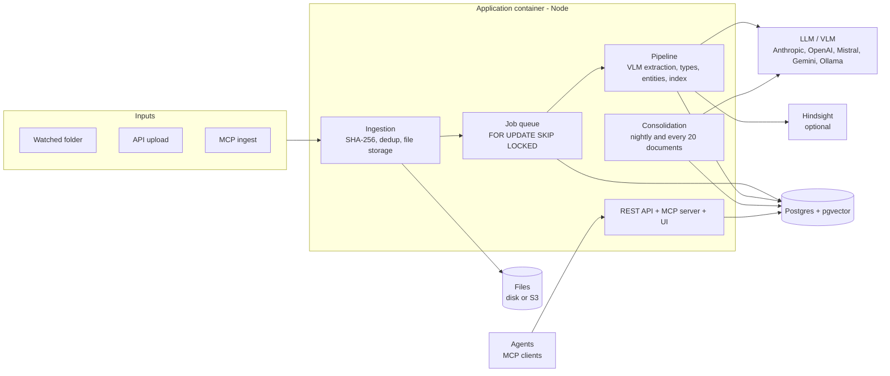
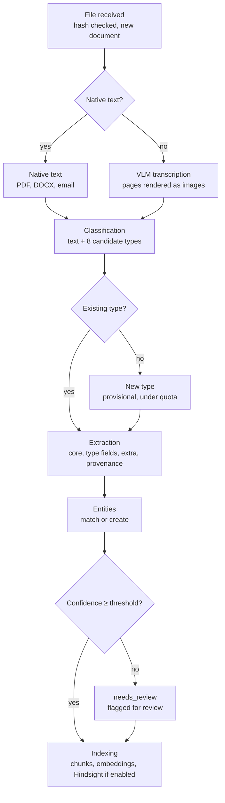

# Liasse — Specification

*Status: draft, pre-implementation. Last updated 2026-11-14.*

## Vision and principles

Liasse is a lightweight, open-source document management system built for agents first: you hand it documents, it understands them, files them into types it evolves on its own, and exposes everything over MCP. Humans never have to maintain a taxonomy.

**The problem.** Self-hosted document managers (Paperless-ngx, Papra, Readur) rely on classic OCR, manual tags and a UI designed for filing by hand. AI is a bolted-on extension. Agent memory systems (Hindsight) synthesize facts but are not a documentary source of truth.

**Design principles**

- **The file is the source of truth.** Everything else (text, fields, facts, embeddings) is derived and can be regenerated.
- **Agent first.** MCP is the primary interface; the REST API serves it; the UI is a convenience.
- **Small fixed structure, emergent types.** A common core of fields guarantees reliable queries; types and their schemas are proposed by the LLM, then consolidated.
- **Nothing is lost.** Useful information outside the schema goes into `extra`, which feeds schema evolution.
- **Traceability.** Every extracted value keeps its model, schema version, confidence and source quote.
- **Lightweight.** One application container and one Postgres. No broker, no separate worker in the MVP.
- **Swappable models.** Configurable LLM/VLM provider, including local (Ollama).

## MVP scope

The MVP covers ingestion, extraction, the evolving type registry, the knowledge layer, search, MCP and a minimal UI, for a single user. Exit criterion: ingest 200 real personal documents and correctly answer 20 reference questions over MCP.

**In scope**

- Ingestion from a watched folder, API upload and the MCP `ingest` tool.
- Formats: PDF (native or scanned), JPEG/PNG/HEIC, DOCX, `.eml` emails with attachments.
- Three-step pipeline: text (native, or transcribed by a VLM), classification, extraction of core and type fields.
- Evolving type registry with a consolidation job.
- Entity resolution (issuers, recipients).
- Hybrid search (vector + full text) and structured queries.
- MCP server (Streamable HTTP and stdio), REST API and a minimal web UI (list, preview, search, upload, `needs_review` queue, change approval), password-protected.
- Native knowledge layer (key dates, links, subjects, facts); optional sync to Hindsight.
- Deduplication by file hash.

**Out of scope for the MVP**

- Multi-user, organizations, sharing.
- Full admin UI: only the minimal UI is included.
- Ingestion by email address (IMAP), mobile apps, scanning.
- PDF editing or annotation.
- Workflows (approval, signature, reminders): that is the agents' job.
- Application-managed encryption at rest (delegated to storage).

## Architecture

Everything fits in one Node container and one Postgres database: no broker, no separate worker, the job queue lives in Postgres. The LLM is external (or local through Ollama) and Hindsight is optional.



The pipeline is the only component that calls the vision model; consolidation and re-extraction only use text already stored.

## Data model

Eleven Postgres tables: documents, text pages, chunks, types, entities, change log and job queue, plus the four knowledge-layer tables (`document_dates`, `document_links`, `subjects`, `facts`). Files live outside the database (disk or S3), addressed by their hash.

| Table | Role | Key columns |
| --- | --- | --- |
| `documents` | One ingested document | `id`, `sha256` (unique), `storage_key`, `mime`, `original_name`, `hint`, `source` (watch/api/mcp), `status`, `type_id`, `schema_version`, `core` (jsonb), `fields` (jsonb), `extra` (jsonb), `provenance` (jsonb), `title`, `summary`, `private`, `watch_requeues`, `file_deleted_at`, `hindsight_held_since`, `hindsight_sent_hash`, `hindsight_retain_until`, `ingested_at` |
| `document_pages` | Full text per page | `document_id`, `page`, `text`, `language`, `tsv` (tsvector) |
| `chunks` | Search units | `id`, `document_id`, `page_from`, `page_to`, `text`, `language`, `embedding` (vector), `tsv` |
| `doc_types` | Type registry | `id`, `slug`, `description`, `schema` (jsonb), `version`, `status`, `parent_slug`, `aliases` (text[]), `embedding`; the document count is computed from `documents`, never stored |
| `entities` | Issuers, recipients | `id`, `kind` (org/person), `canonical_name`, `aliases` (text[]), `identifiers` (jsonb: company ID, masked IBAN, customer number), `embedding` |
| `type_changes` | Consolidation proposals | `id`, `kind` (merge/promote_field/stabilize/remove_field/split/rename/merge_entity/merge_subject), `payload`, `rationale`, `status` (pending/applied/rejected), `auto` (safe to apply without approval), `created_at`, `decided_at`, `note` |
| `jobs` | Processing queue | `id`, `kind`, `payload`, `status`, `attempts`, `run_after`, `locked_at` |

Knowledge-layer tables are described in [Knowledge layer](#knowledge-layer).

**Document statuses**: `received` → `extracted` → `classified` → `indexed`, or `failed` (with `error`); `needs_review` when confidence is below the threshold. `deleted` marks a tombstone: deleting a document removes its derived rows, blanks its content and keeps only the row with the hash of the file, while a queued job removes the stored file; a removal that gave up during a storage outage is queued again at the next start. A tombstone is not a document for any list, count, search or file request. It is what keeps a file still lying in the watched folder from being ingested again; the same bytes uploaded through the API or MCP revive the document under the same ID. An attachment of an email never revives one, whatever the source of the email.

**Per-field provenance** (in `provenance`):

```json
{
  "amount": {"model": "claude-sonnet-x", "schema_version": 3, "confidence": 0.94, "page": 1, "quote": "Total TTC 84,20 €"},
  "issuer": {"entity_id": "ent_01H…", "match": "alias", "confidence": 0.99}
}
```

A value corrected through `update_document` has the entry `{"manual": true}` (with `entity_id`, `match` and `confidence` for an entity name) and its field is listed in `manual_fields`, with `@type` when the type itself was chosen by hand: no extraction writes such a field again. A change of type by hand owes an extraction for the new type: until one succeeds, the document has no `schema_version` and no `confidence`. A value of the old type stays a field when the new type has a valid field of that name, and moves to `extra` otherwise, with its provenance and its manual mark. Only a correction of the type, the core or the fields clears `needs_review`. One key of `provenance` is not a field name: `@pipeline` records how the text (`method`, `vision_model`, attachment counts), the type (`model`, `confidence`, `outcome`: existing, new, fallback or untyped) and the extraction (`model`, `schema_version`, `truncated`, `rejected_values`, `dropped_identifiers`) were obtained.

**Brokerless job queue**: `SELECT … FOR UPDATE SKIP LOCKED` on `jobs`, workers in the same process. Embeddings via `pgvector` (dimension fixed at install time).

## Ingestion pipeline

Each document goes through three steps: get the text, choose or create its type, extract its fields. The vision model is only called when the document has no usable text layer.



**Text.** A PDF counts as native if it holds at least 100 characters per page on average; otherwise each page is rendered as an image (200 dpi) and transcribed by the VLM, page by page, into Markdown. The fallback also works page by page, so that no text is lost: in a native PDF a page with fewer than 20 characters is transcribed by the VLM, and a scanned PDF longer than `MAX_VISION_PAGES` keeps the text layer of the pages that have one and transcribes the others, failing only when those exceed the limit. Images (JPEG, PNG, HEIC) always go through the VLM.

**Classification.** The text model receives the first 2,000 tokens of the document and the 8 closest types (similarity between the embedding of the document's opening and the embeddings of type descriptions), with their description and one example title. It answers:

```json
{
  "decision": "existing",
  "slug": "energy_bill",
  "confidence": 0.93,
  "new_type": null
}
```

or `"decision": "new"` with `new_type` = `{slug, description, parent_slug, fields}` and a two-sentence justification of why no existing type fits. The prompt enforces reuse by default. If the daily new-type quota is reached, the document gets the closest candidate type and moves to `needs_review`.

**Extraction.** Structured output constrained by a Zod schema generated from the core and the type: `core`, `fields`, `extra` (free keys, enforced primitives), `title`, `summary` (2 sentences) and, for each value, `page` and `quote`. A value without a quote verifiable in the text is rejected.

**Knowledge.** The same extraction call also produces key dates, 1 to 5 facts and candidate subjects. Link detection is a separate call, limited to candidate documents (same issuer, subject or reference, within 12 months). Its `detect_links` job is queued in the transaction that settles the document, and again after each re-extraction; a re-indexing alone queues none.

**Quote verification.** A quote is compared with the page after removing only what carries no meaning: Unicode composition, case, typographic quotes and dashes, and whitespace of any kind (a quote may run over a line break). It must have at least 3 characters and at most 300. It is looked for on the page the model names, then on the others, nearest first, and the provenance records the page it stands on. The quote must also state the value: a text, entity or enum value appears in it, an identifier once both are reduced to their letters and digits, a number or an amount is one the quote writes (decimal comma or point, thousands separators, no currency code or symbol that contradicts the amount), a date is one it writes in digits or in words. A numeric date is read day first, except in an English document (or one of unknown language), where only a date that cannot be read the other way counts. A fact quotes at least 12 characters that name its entities, write its dates and numbers and hold at least half of its significant words, and keeps only the validity its quote states. A notice period's quote writes its amount, in digits or as a word up to twelve, right before its unit. A subject candidate's quote contains its name, and its identifier is kept only when the text writes it, compared on letters and digits. Booleans and the language of the document are not checked. A rejected value is dropped alone and counted; an identifier given for an entity is only used when it is written in the text.

**Confidence.** A document's confidence is the minimum of the classification confidence and the mean confidence of the filled core fields. A list field such as `key_dates` counts as one field, by the mean of its items. A core value that was rejected counts as a field with a confidence of 0, a core value corrected by hand with 1, and a document with no core value has a confidence of 0. Below `CONFIDENCE_THRESHOLD`, it moves to `needs_review` but stays indexed and queryable; so does a document that got the closest type, or none, because a new type was refused or over quota.

**Limits.** Text extraction runs in a child process ended at 768 MiB of resident memory or 120 s of CPU time (`text_memory_limit`, `text_cpu_limit`), or after five minutes without a word to the server while no vision call is pending (`text_process_timeout`, retried). It gets only the environment variables Node and poppler need. One extraction call carries about 60,000 tokens of the document (240,000 characters); a longer document is cut there and the cut is recorded (`provenance["@pipeline"].extraction.truncated`). A `process_document` job runs at most 3 times, each model call making up to 3 provider attempts; a document whose job will not run again, whatever stopped it (an error at the last attempt, or a worker that died during it), ends `failed` with a short code in `error`, never a message. A re-extraction that never succeeds leaves the document indexed, flagged `needs_review` with `reextraction_failed`.

**Target cost**: 1 vision call per page for a scan, 3 text calls per document (classification, extraction, links), 1 embedding call per chunk.

## Evolving type registry

Each document carries two layers of fields: a fixed common core, identical for all documents, and fields specific to its type, defined by a schema the system evolves. Cross-type queries rely on the core, which never changes without a migration.

**Common core (`core`)**

| Field | Primitive | Example |
| --- | --- | --- |
| `document_date` | date | 2026-10-03 |
| `issuer` | entity | EDF |
| `recipient` | entity | Jane Doe |
| `amount` | money | `{value: 84.20, currency: "EUR"}` |
| `period` | period | `{start: 2026-09-01, end: 2026-09-30}` |
| `due_date` | date | 2026-10-18 |
| `reference` | text | invoice, contract or case number |
| `language` | ISO 639-1 enum | fr |
| `key_dates` | list of key dates | see [Knowledge layer](#knowledge-layer) |

All core fields are optional; the LLM only fills what it finds.

**Primitives allowed in type schemas**: `text`, `number`, `boolean`, `date`, `period`, `money`, `entity`, `enum` (listed values), `list<primitive>`, `identifier` (with optional `format`: IBAN, company ID, meter ID…). No free nested objects in the MVP. Schemas are stored as restricted JSON Schema, validated on every write.

**Example type**

```json
{
  "slug": "energy_bill",
  "description": "Bill from an electricity or gas supplier for a home",
  "parent_slug": "bill",
  "version": 3,
  "status": "stable",
  "aliases": ["electricity_bill", "edf_bill"],
  "fields": {
    "energy": {"type": "enum", "values": ["electricity", "gas", "dual"]},
    "meter_id": {"type": "identifier", "format": "PDL"},
    "consumption_kwh": {"type": "number"},
    "supply_address": {"type": "text"}
  }
}
```

**Type lifecycle**

- `provisional`: created at ingestion, usable immediately, schema may change.
- `stable`: promoted by consolidation after N documents (default 5) with no merge proposed.
- `merged`: absorbed by another type; its slug becomes an alias of the target and still resolves in queries.

**Versioning.** Adding a field bumps `version` without touching documents. Renaming, retyping or removing a field creates an explicit migration in `type_changes`, then a re-extraction of the affected documents. Each document keeps the `schema_version` it was extracted with.

**Enforced naming conventions**: snake_case, English, generic to specific (`energy_bill`, never `edf_october`), never an entity name, date or amount in a slug. Hierarchy (`parent_slug`) is limited to two levels. Generated slugs and field names are in English by default whatever the document's language; this is configurable with `SCHEMA_LANGUAGE`.

## Consolidation job

Consolidation prevents type drift: it runs every night and after every batch of 20 new documents, and produces proposals in `type_changes`. Safe changes apply automatically; others wait for approval over MCP or in the UI.

**Steps of a run**

1. **Merge candidates.** For each pair of types whose description similarity exceeds 0.85 (cosine), or whose documents overlap strongly in fields and entities, the LLM receives both schemas and 3 examples of each. It answers `merge` (with target and field mapping), `common_parent` or `distinct`.
2. **Field promotion.** A field present in `extra` for at least 60% of a type's documents (and at least 3 documents) becomes a candidate. The LLM proposes a canonical name and a primitive; name variants (`customer_no`, `customer_number`) are unified.
3. **Stabilization.** A `provisional` type with at least 5 documents and no open merge proposal becomes `stable`.
4. **Cleanup.** A schema field filled in fewer than 10% of the documents of a `stable` type with 20 documents or more is proposed for removal.
5. **Application.** For each applied change: registry update, alias added, then re-extraction jobs for the affected documents.

**Re-extraction.** It starts from the text stored in `document_pages`, without calling the vision model again, using the new schema. The cost is one text LLM call per document. Unchanged values keep their original provenance.

**Auto-apply policy**

| Change | Automatic | Condition |
| --- | --- | --- |
| Stabilization | Yes | Criteria above |
| Field addition (promotion) | Yes | No name or primitive conflict |
| Merge of provisional types | Yes | LLM confidence ≥ 0.9 and lossless mapping |
| Merge involving a stable type | No | Approval required |
| Field removal or retyping | No | Approval required |
| Entity or subject merge | Yes | A strong identifier is shared |
| Change to the common core | Never | Code migration only |

`AUTO_APPLY=none` disables all automatic application (useful for first trials); `safe`, the default, applies what the table calls automatic; `all` applies every change consolidation proposes. `type_changes.auto` records whether a change is safe by the table, whatever the mode.

**Rules of consolidation.**

- *Triggers.* Runs go through the job queue (`consolidate`), one at a time across every process: a run holds a session advisory lock, and a run that finds another in progress ends at once. A nightly run is due at 03:00 UTC: one is queued at startup, and each nightly run queues the next as it starts, so a run that fails does not end the chain. After each indexing, a run is queued when 20 documents ingested since the last run started have settled and no run is queued.
- *Proposals once.* A pair of types put to the model is recorded whatever it answers: `merge` as a pending change, `distinct` and `common_parent` as a rejected one, so the pair is never asked about again. Consolidation does not create common parents. Overlap means a share of common field names (Jaccard) of at least 0.7 and a share of common issuers of at least 0.5. A key of `extra` named by a promotion, a removal pending or rejected, a stabilization pending or rejected are not proposed again; at most 10 pairs of types go to the model per run, the most similar first. A model answer outside its schema skips its item until the next run.
- *What the model reads.* The two schemas and the titles and values of the three most recent public documents of each type for a merge; the frequent keys of `extra` with three values of public documents each for a promotion. All of it is delimited as untrusted and masked again; the model never reads a document's text here.
- *Application.* A change is decided once, under a lock on its row, by a person (`apply_change`) or by the policy at the end of a run, merges first. The policy reads again under that lock whether the change is still safe, from the registry as it is then: a merge marked safe is not once a type became stable, nor a promotion once its field got another definition; such a change loses its `auto` flag and waits for approval under `AUTO_APPLY=safe`. The documents of the type are moved in the transaction of the registry write, before it: their values are renamed by the mapping or the promotion and kept as fields where the schema has a field they fit, in `extra` under their own name otherwise, with their provenance and their manual mark, placed in one pass from the name each value had, so that no key is both a field and a key of `extra`. On a collision a manual value wins and the name of a field a person cleared stays free; an extracted value that loses its own name to a manual one is dropped, the re-extraction can give it back. A document moved to another type has no `schema_version` until it is extracted again, and keeps its confidence. Every settled document of the type is then queued for re-extraction; a document still on its way is extracted for its type as it is by then. Entity and subject merges rewrite every reference to the source (`facts.entity_ids`, the provenance entries, `documents.subject_ids`, `facts.subject_ids`) and queue no re-extraction.
- *Refusals.* A change the current state refuses (a type merged meanwhile, a field redefined since a promotion was proposed without a retyping, a hierarchy that would get a third level, two entities of different kinds, an entity gone) is rejected with the reason as its note, and what it moved is undone. It is never tried again.
- *Manual corrections.* A value a person corrected is never overwritten: it moves with its mark and the re-extraction keeps it.

## Entity resolution

Entities are managed locally and deterministically: it is the most queried field ("everything from EDF") and must not depend on an external service.

**Algorithm at ingestion**, for each entity mentioned by the extraction:

1. **Strong identifier**: if a company ID, VAT number or known customer number matches, attach directly.
2. **Normalized name**: lowercase, no accents, no legal form (SA, SAS, Ltd, Inc…); equal to the canonical name or an alias → attach.
3. **Similarity**: embedding of the name and context; above 0.92, attach and add an alias; between 0.80 and 0.92, the LLM arbitrates among the 3 closest candidates.
4. **Otherwise**: create a new entity.

Entity merges go through `type_changes` (kind `merge_entity`) with the same policy: automatic if a strong identifier is shared, approval otherwise. Consolidation proposes a merge for every pair of entities of one kind that share a global identifier or a normalized name.

An IBAN or a card number carried by an entity is a strong identifier too, matched through its hash. A customer number is scoped to the entity that issued it: it attaches only when it has at least 6 characters once normalized and no other entity of the same kind carries it (otherwise the name rules decide), and sharing one never makes a merge automatic. An identifier of a free format is kept but never attaches or merges anything. A document never makes two entities share a strong identifier: a mention whose identifiers designate more than one entity is resolved by the name and similarity rules, and an entity never takes an identifier another entity carries; what the mention suggests is kept as a merge proposal that needs an approval. A fragment is not an identifier: a company ID under 5 characters, a VAT number under 4, or either without a digit, is ignored. Names are normalized without accents on Latin letters only: in other scripts a mark is part of the word. A name or similarity match yields when the entity and the mention carry different company IDs or VAT numbers: a new entity is created, since a duplicate can be merged and a wrong fusion cannot be undone. The text model arbitrates outside the entity lock, and its answer is used only if the candidates are still the same once the lock is taken. A mention of a `private` document skips the similarity rule when the embedding provider is external.

An entity-typed value in `core` or `fields` is the name as the document writes it. The entity it designates is in its provenance entry (`provenance.<field>.entity_id`; one entry per item for a list field, `provenance.<field>[i].entity_id`), and that entry is what a merge rewrites, with `facts.entity_ids`.

**Privacy**: IBANs and card numbers are never stored in clear in `identifiers`; only the last 4 characters and a hash are used for matching. The hash is an HMAC-SHA-256 under a key derived from `FILE_URL_SECRET`: without the key it cannot be reversed by enumerating account numbers, and after a change of that secret the stored hashes no longer match until the entity meets its identifier again.

## Knowledge layer

Liasse answers relational and temporal questions on its own ("which contracts expire this quarter?", "when did I switch energy supplier?") thanks to four structures derived at ingestion. Hindsight is not required: it is an optional export.

| Structure | What it captures | Typical question |
| --- | --- | --- |
| `document_dates` | Typed key dates of each document: payment, expiry, renewal, notice, effective date | "What expires this quarter?" |
| `document_links` | Links between documents: supersedes, amends, terminates, pays, replies to, attachment of | "Is this contract still active?" |
| `subjects` | Durable files grouping documents: home, vehicle, contract, job, account | "Everything about my car" |
| `facts` | Dated atomic facts linked to their entities, subjects and source document | "When did I change insurer?" |

**Key dates (`key_dates`).** A document can carry several typed dates: `due` (payment), `expiry` (end of validity), `renewal`, `notice_deadline` (last day to give notice), `effective` (start), `event` (other). Each date keeps its label, confidence and quote. When a contract states a notice period, `notice_deadline` is computed deterministically (`renewal` − notice period), not by the LLM.

**Links and current state.** At ingestion, the LLM receives candidate documents (same issuer, subject or reference, within the last 12 months) and proposes typed links: `supersedes`, `amends`, `terminates`, `pays`, `replies_to`, `attachment_of`. These links give each document a derived state (`current`, `superseded`, `terminated`): a terminated contract no longer shows up in upcoming deadlines.

**Subjects.** Subjects are the things the user owns or holds, as opposed to entities, which are the organizations and people they deal with. Subject kinds: `property`, `vehicle`, `contract`, `employment`, `account`, `dependent`. They are resolved like entities (strong identifiers: license plate, contract number, address, then similarity), and a document can concern several subjects. Subject merges go through `type_changes` (kind `merge_subject`).

**Facts.** The extraction call produces 1 to 5 short facts per document, each with `valid_from`, `valid_to`, its entities, its subjects and the document ID. They are indexed for vector and full-text search. Recall combines hybrid search over facts, a temporal filter ("valid at date X") and a one-hop expansion through related entities and subjects. No opinions, no reflection: only sourced facts.

```text
[doc:01JC…] The MAIF home insurance contract for the Lyon apartment renews automatically every March 1st; 2-month notice period. (valid_from 2025-03-01)
```

**Rules of the knowledge layer.**

- *Notice deadline.* Extraction gives the notice period as a number of days, weeks or months, at most five years. The deadline is each renewal date minus that period, with no model and no quote in its trace, and as sure as the less sure of the two; it replaces every `notice_deadline` the model proposed. Months are counted on the calendar and keep the day of the month, the last day of a shorter month standing in for it: two months before March 31 is January 31, one month before it the last day of February. A notice period that is not valid is dropped alone and counted with the rejected values; the rest of the knowledge is kept.
- *Subjects.* A plate, a vehicle identification number, an IBAN or a card number attaches a subject on its own (IBANs and card numbers are kept as their last four characters and a keyed hash, as on entities). A contract, job or account number is scoped to the entity that issued the document, like a customer number: it attaches on its own only when its issuer is known, it has at least 6 characters, and one subject carries it for that issuer. Two different numbers still tell two contracts apart, whoever issued them. An address attaches only when written in full: a house number, possibly with `bis`, `ter`, `quater` or a letter, before its street (or after it, as in German), then a postal code. A number inside the name of a street, a building, an apartment or a post-office box is not a house number, and a shorter form of an address never tells two properties apart. Then the label, compared without case, accents on Latin letters or punctuation, and a label under 3 characters never matches. Then similarity, with the thresholds of entities. Two values of one identifier type on both sides, two plates for instance, make two subjects. A fact names its subjects by the labels of the candidates of its document; a label that designates none of them names nothing.
- *Subjects and private documents.* A private document may attach to a subject, but nothing it says is stored on it: no identifier, alias or label. A subject a private document creates is private: no reader sees it without asking for private documents. The first public document attached to it makes it public, and its label, identifiers and embedding are then those of that document; what private documents said goes. A merge pools the names of two subjects of one standing; a public result keeps only the names of its public side. A subject that no live document concerns any more, once its last document is deleted or no longer names it, is blanked: no label, alias, identifier or embedding, so it attaches nothing and shows nowhere.
- *Facts.* An IBAN or a card number left in a fact, a key date or a link rationale is masked, never stored in clear. A fact of a private document under an external embedding provider has no embedding and is found by full text only.
- *Links.* Candidates are at most 12 documents, never tombstones; private documents are candidates too, since the private flag never kept a document from the text model, which read its whole text at extraction. They are ranked by the type of the document first, then documents that state a renewal, expiry or effective date, then the same reference, a shared subject and the most recent; one type takes at most 6 places while documents of other types are there, so a year of bills cannot crowd out the contract. A link is kept when its confidence is at least 0.7, when a document that supersedes, amends, terminates or replies to another is not dated before it, and when a payment is in the currency of what it pays and not larger. Across every detection, a document supersedes one document (the first found stays) and is superseded by one (the more recent superseder wins, then the surer link, then the one already written), and no chain of `supersedes` loops. A termination wins over a newer version; an amendment takes the state of the document it amends, along a chain of amendments to its root. Deleting a document gives the documents it superseded or terminated their state back.
- *Reading.* `upcoming`, `timeline`, `recall` and `get_subject` leave out tombstones always and private documents and private subjects unless asked. A subject that no visible document concerns is not found: all that is known of it came from documents the caller may not see. A contract, a job or an account is current while one of the documents of its contract is; a property, a vehicle or a dependent while any of its documents is.

**End-to-end example.** For "which contracts expire this quarter?", the agent calls `upcoming` with the quarter as window and kinds `expiry`, `renewal` and `notice_deadline`. Liasse returns the dates sorted, each with its document, subject and state; terminated or superseded contracts are excluded by default. The agent only calls `get_document` when it needs exact details.

## Hindsight integration (optional)

The Hindsight integration is optional: the native knowledge layer is enough for relational and temporal questions. It serves users who want their agents to find their documents in the same memory as the rest of their context. Liasse never delegates storage or exact retrieval to it.

**What is sent.** After indexing, one `retain` into a dedicated bank (default `documents`) with the document's facts (`facts` table), never its full text. The memory is one line per fact, each citing its document and its validity, stored under the document ID as its Hindsight `document_id`:

```text
[doc:01JC…] EDF energy bill dated 2026-10-03 for 2026-09-01 to 2026-09-30, amount €84.20, due 2026-10-18, supply address 12 rue des Lilas, Lyon. (valid_from 2026-10-03)
```

It carries as metadata the document ID, the type slug, the document date and the validity range of the facts, and the document date as its timestamp. The bank needs no setup: Hindsight creates it at the first retain.

**What is not sent**: full text, title, summary, core and type fields, documents flagged `private`, deleted documents, and any fact in which the sensitive-identifier detector finds an identifier. A fact is free text written by the model and nothing masks it upstream, so the detector is the only guard at this boundary: the integration cannot be created without one, a flagged fact is left out of the retain, and the count of facts left out is reported. The detector is the one of entity resolution, which finds IBANs and card numbers; a tax or social security number written in a fact is not detected.

**Updates.** Every change Hindsight must follow queues a `hindsight_sync` job in the transaction of that change: a document indexed, extracted again, flagged private or public, or deleted. The job reads the document and decides. For a live document that is not private, it retains the facts again under the same ID when they differ from the ones Hindsight confirmed, which replaces them: Hindsight deletes the memories of an existing `document_id` before it stores the new ones. For a document that is private, deleted or left without a fact to send, it asks Hindsight to delete the document and its memories (`DELETE /v1/default/banks/{bank}/documents/{id}`) whenever the bank may hold them.

**What the bank may hold.** `documents.hindsight_held_since` is set, and committed, before the first retain of a document is sent, and cleared only when Hindsight confirms that it holds nothing of it (a successful delete, or its 404 `Document not found`) and no retain sent for it can still reach Hindsight. `documents.hindsight_retain_until` says until when one can: every retain sets it, before its request, to the longest the request can take with its retries, plus ten seconds for the time before it leaves (about six minutes in all), and a retain Hindsight answered with a success puts back the bound it found, or none once that bound has passed. A forget that finds the bound ahead is sent all the same, keeps the record and runs again once the bound has passed, so a retain whose sync lost its lock, or died, can never land after the last forget with nothing left to say that the bank holds its facts. Whatever happens in between (a retain that timed out after Hindsight stored it, an answer the client refused, a deletion, the same bytes ingested again, which revives the document under its ID), the row still says a forget may be owed; a tombstone keeps this column. The end of every request, whatever its outcome, sets it again if another sync cleared it meanwhile and clears the hash: what the bank holds is then not known. `documents.hindsight_sent_hash` is the hash of the facts Hindsight confirmed and of the bank they went to, recorded only while the sync still holds its lock and the facts are still the ones it sent; it only lets an unchanged sync make no request. A forget whose job gave up stays owed on the row: at startup, a sweep queues a sync again for every deleted or private document the bank may hold and that has no sync queued or running.

**Concurrency.** A sync runs every statement on one connection it reserves, so it needs one connection whatever the size of the pool, and no transaction is open while a request to Hindsight is in flight. Syncs of one document exclude each other through an advisory lock held by that connection; a second one stops at once and is deferred. A lock is lost with its connection (a database restart, a network cut, a terminated session): the sync that lost it records, through the pool, that the bank may hold anything of the document, and is deferred as well; a write that rests on the lock checks, in the same statement, that its connection still holds it. A deferred job runs again after the first delay of the retry policy (5 s), or once the bound of a retain in flight has passed, without spending one of its 8 attempts and without being logged as a failure (`job_deferred`, not `job_failed`): each of these waits ends by itself. The workers run at most 2 `hindsight_sync` jobs at a time, a bound on throughput and on the connections a stalled Hindsight holds.

**Limits.** Forgetting is per document, which is all Liasse needs; Hindsight has no deletion of a single memory. What Hindsight derived from the facts before the deletion and stored outside the document (observations consolidated across documents) is its own to maintain. A document flagged private while its retain is in flight is sent, then forgotten by the sync its flag queued. Changing `HINDSIGHT_URL` or `HINDSIGHT_BANK` retains the documents again in the new bank as they are synced and does not empty the previous one: a forget then asks the new bank, which answers that it holds nothing, and the record is cleared although the old bank still holds the facts. Empty the old bank by hand before changing either variable. Disabling the integration leaves in Hindsight what was sent, and leaves the owed forgets on the rows until it is enabled again. Any 404 other than Hindsight's own `Document not found` fails the forget and leaves it owed. The bound of a retain in flight is the one of the client: a retain Hindsight received and still processes after the client gave up on it, past its last attempt, can land after a forget that cleared the record. A retain that failed keeps its bound, since it may still land, so a forget within six minutes of it is sent twice. Facts the detector of sensitive identifiers left out are counted in a `hindsight_facts_withheld` log line, which names no document. Hindsight must be version 1.2 or later.

**Agent side.** Without Hindsight, the agent uses `upcoming`, `timeline` and `recall`. With Hindsight, it can also query its global memory, collect the cited `[doc:…]` IDs, then call `get_document` for exact details.

## Search

Two modes coexist: hybrid natural-language search over chunks, and structured queries over core and type fields. Both return documents with the snippets that justify the result.

**Hybrid search (`search`)**

- Full text: Postgres `tsvector` with a language-aware configuration + `unaccent` (BM25 through ParadeDB `pg_search` as an option, if installed). Each row is indexed in the language of its document (`core.language`, falling back to an unstemmed configuration); a query is read in every language present in the index, so it needs no language of its own.
- Vector: `pgvector`, HNSW index, query embedding.
- Fusion: Reciprocal Rank Fusion (k = 60), then grouping by document (best chunk + at most 2 snippets).
- Combinable filters: type (aliases resolved), entity, subject, date range, status.
- Cross-encoder reranking: out of the MVP, planned behind a flag.

**Chunking**: per page, then split at about 800 tokens with 100 tokens of overlap, bounded by the input window of the embedding model when that window is known. The title and type are prefixed to each chunk before embedding, and the chunk and its prefix are sized to fit in the window, so that no text is left out of every embedding. The default local model states its window (512 tokens, about 480 of them for the chunk) and sizes chunks with its own tokenizer. A remote provider does not: its window is what `EMBEDDING_MAX_INPUT_TOKENS` says, chunks are then sized with a conservative estimate, and when the variable is unset chunks keep 800 tokens, which a model with a smaller window truncates without an error; the server says so at startup.

**Structured queries (`query`)**: a JSON DSL compiled into parameterized SQL; agents never send SQL.

```json
{
  "type": "energy_bill",
  "where": [
    ["core.issuer", "=", "EDF"],
    ["core.document_date", ">=", "2026-01-01"],
    ["fields.consumption_kwh", ">", 300]
  ],
  "order_by": ["core.document_date", "desc"],
  "aggregate": {"sum": "core.amount.value"},
  "limit": 50
}
```

Operators: `=`, `!=`, `<`, `<=`, `>`, `>=`, `in`, `contains`, `exists`. Aggregates: `count`, `sum`, `min`, `max`, `avg`, with optional `group_by`. An unknown field returns an error listing the available fields, so the agent can correct itself.

## MCP contract

Fourteen tools, over Streamable HTTP (`/mcp`, Bearer token auth) and stdio. All outputs are compact JSON; documents are referenced by ID and never returned in full unless explicitly requested.

| Tool | Role | Main inputs | Output |
| --- | --- | --- | --- |
| `describe_types` | Discover types and their schemas | `status?`, `include_examples?` | Types with description, fields, document count, aliases |
| `search` | Hybrid natural-language search | `query`, `filters?`, `limit?` (default 10) | Documents with title, type, core, 1–3 snippets (text and highlight ranges), score |
| `query` | Structured query (DSL) | DSL object | Rows (ID, core, requested fields) or aggregates |
| `get_document` | Document details | `id`, `include` (`fields`, `text`, `pages`, `file_url`, `provenance`) | Document; paginated text if long |
| `list_entities` | List or search entities | `query?`, `kind?` | Entities with aliases and document count |
| `ingest` | Add a document | `file` (base64) or `url`, `filename`, `hint?`, `private?` | ID and status; asynchronous processing |
| `get_status` | Track processing | `id` | Status and state, error if any |
| `update_document` | Correct a document | `id`, `type?`, `core?`, `fields?`, `private?` | Updated document (provenance `manual`) |
| `list_pending_changes` | See consolidation proposals | `kind?` | Pending changes with rationale, oldest first (at most 100, `truncated`) |
| `apply_change` | Approve or reject | `id`, `decision` (`apply`/`reject`), `note?` | Result and number of documents to re-extract |

**Knowledge-layer tools**

| Tool | Role | Main inputs | Output |
| --- | --- | --- | --- |
| `upcoming` | Key dates in a window | `from`, `to`, `kinds?`, `types?`, `subject?`, `current_only?` (default true) | Sorted dates with label, document, subject, state |
| `timeline` | Chronology of a subject or entity | `subject` or `entity`, `from?`, `to?` | Dated facts and documents, in order |
| `recall` | Fact search, memory-style | `query`, `at?` (validity date), `limit?` | Facts with validity and source document |
| `get_subject` | Subject details | `id` or `query` | Subject, linked documents, current state, next dates |

**Conventions**

- Tool descriptions guide the agent: call `describe_types` before `query`, prefer `query` for numeric questions and `search` for fuzzy ones, never invent a missing value.
- `file_url` is a signed URL valid for 15 minutes, never the storage path.
- A manual correction (`update_document`) takes precedence: consolidation never overwrites it.
- `ingest` is exposed to agents by default. It takes the file itself, base64-encoded; `url` answers `not_implemented` for now, since fetching an address an agent chose (possibly read from a document) needs its own safeguards against reaching the hosts of the server's network.
- MCP resources: `doc://{id}` (the document with the first 100,000 characters of its text, as JSON; private documents included, as with `get_document`) and `types://` (the registry, counts without private documents), for clients that support them. Documents are not listed as resources.

**Transports**

- **Streamable HTTP** on `/mcp`, behind the same Bearer tokens as the REST API and with the request deadline of an upload. The server is stateless: one server per `POST`, answered as JSON, no session; `GET` and `DELETE` answer 405. A message may hold a base64 file of `MAX_FILE_SIZE` plus 1 MiB; the JSON depth limit of the REST API applies.
- **stdio** with `liasse --stdio` (`node dist/main.js --stdio`): the same process as the server, workers and watched folder included, speaking MCP on its standard streams instead of listening on HTTP. No credential: whoever starts the process holds them. It exits with code 0 when its input ends. The `file_url` it signs opens on the HTTP server of `PUBLIC_URL`, when one runs. Everything the process says about itself goes to stderr.

**Results and errors**

- A tool answers compact JSON in one text content. A failure is a tool error (`isError`) whose text is `{"error": {"code", "message", …}}` with the codes of the REST API; a feature this build does not provide answers `not_implemented` where REST answers 501. An unexpected failure answers `internal_error`, and only its class is logged.
- Arguments are checked against strict schemas derived from those of the REST API; the SDK refuses those that do not match with an "invalid arguments" tool error. `query` is the exception: the DSL reads its arguments itself, so its errors name the field, type or operator to correct, as `POST /query` does.
- A resource that does not exist answers the JSON-RPC error -32002, with the body a tool would answer as its data.
- `upcoming`, `timeline`, `recall` and `get_subject` reach the knowledge layer through the features the server binds, as `GET /upcoming` and `GET /subjects` do; their answers are those of the knowledge layer. `list_pending_changes` and `apply_change` reach consolidation the same way, as `GET /changes` and `POST /changes/:id` do, and answer what they answer (`@liasse/core/contract`).

## API, configuration and deployment

A single Node binary, configured through environment variables, shipped as a multi-arch Docker image (amd64, arm64) with a `docker-compose.yml` including Postgres and pgvector.

**REST API** (generated OpenAPI, same logic as MCP): `POST /documents`, `GET /documents`, `GET /documents/:id`, `GET /documents/:id/file`, `PATCH /documents/:id`, `DELETE /documents/:id`, `POST /search`, `POST /query`, `GET /types`, `GET /entities`, `GET /subjects`, `GET /upcoming`, `GET /changes`, `POST /changes/:id`, `GET /health`, `GET /metrics` (Prometheus), `GET /openapi.json`.

- **One logic, two transports.** The use cases live in `@liasse/core/api`; REST and MCP both call them, so a tool and its route answer the same thing.
- **Credentials.** Every route needs `Authorization: Bearer <token>`, `/metrics` and `/openapi.json` included. Two exceptions: `GET /health` is open and only says whether the database answers, and `GET /documents/:id/file` also accepts a signed URL.
- **Documents.** `POST /documents` takes a multipart form (`file`, optional `hint` and `private`) or the raw bytes (`Content-Type: application/octet-stream`, name in `X-Filename`); it answers 201 for a new document and 200 for bytes already known. `GET /documents` lists documents, most recent first, filtered by `status`, `type` and `private` (`exclude` by default, `include`, `only`); the web UI uses it for its list and its review queue. `GET /documents/:id` returns a private document, since naming it is asking for it. `DELETE` answers 204, then 404: a deleted document is not a document.
- **Signed file URLs.** `file_url` is `PUBLIC_URL/documents/:id/file?expires=…&signature=…`: an HMAC-SHA-256 of the document ID and the expiry, under a key derived from `FILE_URL_SECRET`. It opens that one file, for 15 minutes, any number of times, and nothing else. It stops working when the document is deleted and works again if the same bytes revive the document before it expires. It is issued only to an authenticated caller, private documents included.
- **Files are served as data.** `Content-Disposition` is `attachment` except for PDF, JPEG and PNG, always with `X-Content-Type-Options: nosniff` and `Content-Security-Policy: sandbox`.
- **Errors** are `{"error": {"code", "message", "request_id", …}}` with stable codes. A route whose feature is not part of the build answers 501 `not_implemented`.
- **Private documents in counts.** The document counts of `GET /types` and `GET /entities` leave private documents out unless `include_private=true`, as search and queries do.
- **Changes.** `GET /changes` lists the pending changes, oldest first, filtered by `kind`; at most 100, with `truncated` when more are pending. `POST /changes/:id` answers with the change as decided, the number of documents queued for re-extraction and, for an application the current state refused, the `refusal` (`code`, `message`); a change already decided answers 400 `change_already_decided`.
- **Subjects.** `GET /subjects` lists the subjects a public document concerns, oldest first, each with its kind, name, aliases and number of public documents, filtered by `kind` and by a `query` read as `get_subject` reads it; at most 100, with `truncated` when more match. Like the knowledge tools, it never shows a private subject or one known only through private or deleted documents.
- **No CORS.** The API allows no other origin; the web UI is served from the same one.
- **Shutdown.** SIGTERM or SIGINT stops accepting requests, lets requests and jobs in progress finish within a grace period, then exits with code 0 (1 if a part could not be stopped). Any second signal exits at once with code 1.

**Main variables**

| Variable | Default | Role |
| --- | --- | --- |
| `HOST` / `PORT` | `127.0.0.1` / `8080` | Address the server listens on |
| `PUBLIC_URL` | `http://HOST:PORT` | Origin clients reach the server at; signed file URLs start with it, never with the `Host` of a request |
| `DATABASE_URL` | — | Postgres 16+ with pgvector 0.8+ |
| `STORAGE_DRIVER` | `fs` | `fs` or `s3` |
| `STORAGE_PATH` / `S3_*` | `/data/files` | File location |
| `S3_REQUEST_TIMEOUT` / `S3_MIN_UPLOAD_RATE` | `30s` / `65536` | Deadline of one S3 request; an upload gets it plus its size at this rate (bytes per second) |
| `WATCH_DIR` | empty | Watched folder (disabled if empty) |
| `MAX_FILE_SIZE` | `52428800` | Largest accepted file, in bytes |
| `LLM_PROVIDER` | `anthropic` | `anthropic`, `openai`, `mistral`, `gemini`, `ollama`, `openai-compatible` |
| `VISION_MODEL` | — | Model for extraction from images |
| `TEXT_MODEL` | — | Model for classification, re-extraction, consolidation |
| `LLM_TIMEOUT` | `5m` | Upper bound for one text or vision model call, its retries included |
| `EMBEDDING_TIMEOUT` | `1m` | Upper bound for one embedding request, its retries included |
| `EMBEDDING_PROVIDER` / `EMBEDDING_MODEL` / `EMBEDDING_DIM` | `local` | Embeddings (dimension fixed at install time) |
| `EMBEDDING_CACHE_DIR` | `/data/models` | Model files of the local embedding provider |
| `EMBEDDING_MAX_INPUT_TOKENS` | empty | Tokens a remote embedding model reads per input; chunks are sized to fit (the local model states its own) |
| `AUTO_APPLY` | `safe` | `none`, `safe`, `all` |
| `CONFIDENCE_THRESHOLD` | `0.7` | Below: `needs_review` |
| `MAX_NEW_TYPES_PER_DAY` | `5` | Beyond: closest type + `needs_review` |
| `SCHEMA_LANGUAGE` | `en` | Language of generated slugs and field names: `en`, `fr`, `de`, `es` or `it` |
| `HINDSIGHT_URL` / `HINDSIGHT_BANK` / `HINDSIGHT_API_KEY` | empty / `documents` / empty | Optional integration: base URL of the Hindsight server (disabled if empty), bank, Bearer key |
| `API_TOKENS` | — | Bearer tokens (list) for API and MCP |
| `FILE_URL_SECRET` | required | Secret the keys of signed file URLs and of identifier hashes are derived from |
| `UI_PASSWORD` | empty | Enables the web UI (plain value or `$argon2id$…` hash) |
| `UI_SESSION_TTL` | `7d` | UI session lifetime |
| `WORKERS` | `2` | Jobs processed in parallel |

**Temperature.** Every call to `TEXT_MODEL` and `VISION_MODEL` asks for temperature 0, so that the same input gives the same output as far as the provider allows. The reasoning models of OpenAI do not accept the setting: the provider adapter drops it for them, and their output can differ from one call to the next.

**Watched folder.** With `WATCH_DIR` set, Liasse ingests every file of that folder and of its subfolders, those present at startup and those dropped later. It only reads the folder: it never moves, renames or deletes a file, so what was ingested stays where the user put it and is recognised by its hash at the next start. A file is read once its size and modification time have held still for two seconds. A writer that pauses longer than that in the middle of a file gets the partial file ingested as it is, and the complete file ingested as a second document when it changes again. A tool that writes under a temporary name (a leading dot, `.part`, `.tmp`, `.crdownload`) and renames at the end is safe: the watcher ignores those names. Hidden files and folders are ignored, symbolic links are not followed, and a subfolder that cannot be read is reported once and skipped. A file refused for what it is (unsupported format, empty, larger than `MAX_FILE_SIZE`) is not read again until it changes. Deleting a document does not delete its file from the folder, and the file is not ingested again. A document whose processing failed is queued again once when the folder hands its file back at a restart, and no more after that: uploading the file through the API or MCP always queues it again.

**Local embeddings by default.** `EMBEDDING_PROVIDER=local` runs a small quantized multilingual model on the same host (ONNX Runtime): around 384 dimensions and roughly 100 MB, with candidates to be compared on the evaluation set (for example the multilingual-e5-small family). The model files are downloaded into `EMBEDDING_CACHE_DIR` on first use, unless the directory already holds them (pre-filled image or mounted volume), after which no network access is needed. The model runs in a child process of the server, started on first use and ended after 10 minutes of inactivity: ONNX Runtime does not return its memory to the operating system when a model is released in place, so ending the process is what meets the idle RAM target. While it works, the model process peaks between 0.8 and 1.35 GB with batches of four inputs (measured on inputs of 512 tokens: 0.83 GB on Linux arm64 with Node 22; 1.09 to 1.32 GB on macOS arm64 with Node 24, where the peak varies from run to run and grows with the length of the run more than with anything else). The process serves one batch at a time, in the order the batches arrive, whatever the number of workers asking: `process_document` embeds in up to `WORKERS` jobs at once, and their batches take turns, so the peak stays the one of a single batch (two concurrent requests of 64 inputs measured 1.06 to 1.31 GB on macOS).

**Web UI.** Enabled only when `UI_PASSWORD` is set. Session cookie `HttpOnly`, `Secure`, `SameSite=Strict`, 7-day lifetime; at most 5 login attempts per minute per IP. The UI calls the same API as MCP.

**Tech stack**

- TypeScript, Node 22, Hono (HTTP), Drizzle (ORM and migrations), Zod (validation, JSON Schema generation).
- Official MCP TypeScript SDK.
- Vercel AI SDK for LLM provider abstraction, with structured outputs.
- PDF → images: `pdftoppm` (poppler) in the image; native text extraction with `pdfjs` when the PDF has a text layer, to save vision calls.
- Tests: Vitest, with a synthetic document set (no real documents in the repository).

**Resource target**: under 150 MB of RAM at idle for the application container, excluding Postgres.

## Safeguards, security and privacy

Documents are personal and sensitive (taxes, health, banking): privacy by default comes before convenience, and document content is treated as data, never as instructions.

**Prompt injection.** Text extracted from a document may contain malicious instructions. It is always passed to the LLM in a delimited block marked as untrusted; outputs are constrained by a strict Zod schema; no LLM output triggers any action other than writing validated fields. MCP tool descriptions flag document content as untrusted.

**Registry safeguards**

- Maximum number of new types per day (`MAX_NEW_TYPES_PER_DAY`).
- Capped schema size (30 fields per type), two hierarchy levels.
- Slug validation (regex, denylist: known entity names, dates, numbers).
- No automatic change to the common core.

**Privacy**

- LLM provider of your choice, including 100% local (Ollama); warning at startup when a cloud provider is configured.
- Per-document `private` flag: excluded from Hindsight, from embeddings sent to an external provider, and from `search` results unless explicitly requested.
- An embedding endpoint is external unless it is the in-process model, or an Ollama or OpenAI-compatible server whose base URL host is a loopback or private IP address, or a name that resolved at startup to such addresses only; a cloud provider is always external, and a DNS change after startup is not re-checked.
- Sensitive identifiers (IBAN, tax number, social security number) masked in `core`, `fields` and provenance; the full value is only readable in the document's full text.
- No telemetry.

**Access**: Bearer tokens for API and MCP, password for the UI, constant-time comparisons; signed, short-lived file URLs; no public listener by default (binds to `127.0.0.1` unless configured).

## Open source

Liasse is published under AGPL-3.0 at github.com/wallforfry/liasse from the first commit. AGPL prevents a closed SaaS fork and leaves the door open to a hosted offering; Apache-2.0 was ruled out for that reason.

**Contributions**: DCO required (`Signed-off-by` on every commit), no CLA.

**Language**: everything in the project is in English — code, identifiers, schemas, comments, commit messages, issues, PRs, documentation, prompts, error messages and MCP tool descriptions.

**Repository**

- pnpm monorepo: `apps/server`, `packages/core` (pipeline, registry), `packages/mcp`, `packages/sdk` (TS client), `docs/`.
- `README` focused on a 5-minute start (`docker compose up`), `CONTRIBUTING.md`, `SECURITY.md`, code of conduct.
- `AGENTS.md` (and `CLAUDE.md`) at the root: conventions, commands, testing rules, so agent-assisted contributions stay consistent.
- GitHub Actions CI: lint, tests, multi-arch image build, publication to GHCR on every tag.
- SemVer, generated changelog (Changesets).

**Public evaluation set**: 50 synthetic documents (bills, contracts, notices, fictitious payslips) with expected ground truth. It drives prompt regression tests and model comparisons, and is a good launch asset.

## Roadmap

Four milestones with no dates: each is passed on a measurable criterion, not a calendar. v0.3 matches the MVP exit criterion; v1.0 is the public launch.

| Milestone | Content | Exit criterion |
| --- | --- | --- |
| v0.1 Foundations | Ingestion, dedup; native text + VLM; hybrid search; read-only MCP; minimal UI | Search works on 50 documents |
| v0.2 Evolving types | Classification; extraction + core; versioned registry; entities, query DSL | 100 documents, fewer than 20 types |
| v0.3 Consolidation | Merges, promotions; re-extraction; approval tools; knowledge layer | 200 documents, 20 reference questions answered |
| v1.0 Public launch | Evaluation set; docs + examples; multi-arch image; announcement | — |

v0.1 is useful on its own: an archive searchable by agents, before classification even exists. "Fewer than 20 types" for 100 documents guards against drift before consolidation is turned on.

## Decisions and open questions

| Question | Decision |
| --- | --- |
| Name | Liasse; available on GitHub, npm and as a domain |
| License | AGPL-3.0 |
| Default embeddings | Local, with a lightweight model loaded on demand |
| Expose `ingest` to agents | Yes, by default |
| UI in v0.1 | Yes, a minimal UI protected by a password (`UI_PASSWORD`) |

Still open:

- [x] Does Hindsight support targeted forgetting by memory ID? Not by memory ID, but by document ID, which is the granularity Liasse retains at: `DELETE /v1/default/banks/{bank}/documents/{id}` deletes a document and its memories, and a retain under an existing `document_id` replaces them (checked against Hindsight 1.2.1, 2026-11-14). Document deletion and the `private` flag are therefore propagated; see [Hindsight integration](#hindsight-integration-optional).
- [ ] Consolidation thresholds (0.85 similarity, 60% presence, 5 documents): to be calibrated on the evaluation set.
