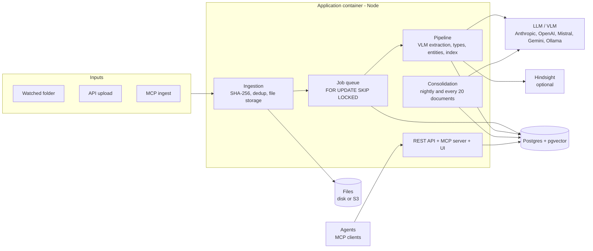
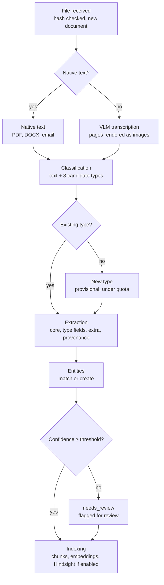

# Liasse — Specification

*Status: describes the implemented design. Last updated 2026-11-17.*

## Vision and principles

Liasse is a lightweight, open-source document management system built for agents first: you hand it documents, it understands them, files them into types it evolves on its own, and exposes everything over MCP. Humans never have to maintain a taxonomy.

**The problem.** Self-hosted document managers (Paperless-ngx, Papra, Readur) rely on classic OCR, manual tags and a UI designed for filing by hand. AI is a bolted-on extension. Agent memory systems (Hindsight) synthesize facts but are not a documentary source of truth.

**Design principles**

- **The file is the source of truth.** Everything else (text, fields, facts, embeddings) is derived and can be regenerated.
- **Agent first.** MCP is the primary interface; the REST API serves it; the UI is a convenience.
- **Small fixed structure, emergent types.** A common core of fields guarantees reliable queries; types and their schemas are proposed by the LLM, then consolidated.
- **Nothing is lost.** Useful information outside the schema goes into `extra`, which feeds schema evolution.
- **Traceability.** Every extracted value keeps its model, schema version, confidence and source quote.
- **Lightweight.** One application container and one Postgres. No broker, no separate worker in the MVP.
- **Swappable models.** Configurable LLM/VLM provider, including local (Ollama).

## MVP scope

The MVP covers ingestion, extraction, the evolving type registry, the knowledge layer, search, MCP and a minimal UI, for a single user. Exit criterion: ingest 200 real personal documents and correctly answer 20 reference questions over MCP.

**In scope**

- Ingestion from a watched folder, API upload and the MCP `ingest` tool.
- Formats: PDF (native or scanned), JPEG/PNG/HEIC, DOCX, `.eml` emails with attachments.
- Three-step pipeline: text (native, or transcribed by a VLM), classification, extraction of core and type fields.
- Evolving type registry with a consolidation job.
- Entity resolution (issuers, recipients).
- Hybrid search (vector + full text) and structured queries.
- MCP server (Streamable HTTP and stdio), REST API and a minimal web UI (list, preview, search, upload, `needs_review` queue, types, change approval, ingestion sources), password-protected.
- Native knowledge layer (key dates, links, subjects, facts); optional sync to Hindsight.
- Deduplication by file hash.

**Out of scope for the MVP**

- Multi-user, organizations, sharing.
- Full admin UI: only the minimal UI is included.
- Ingestion by email address (mail sent to an address of Liasse), mobile apps, scanning. Reading a mailbox over IMAP is an [ingestion source](#ingestion-sources).
- PDF editing or annotation.
- Workflows (approval, signature, reminders): that is the agents' job.
- Application-managed encryption at rest (delegated to storage).

## Architecture

Everything fits in one Node container and one Postgres database: no broker, no separate worker, the job queue lives in Postgres. The LLM is external (or local through Ollama) and Hindsight is optional.



The pipeline is the only component that calls the vision model on a document, and the settings check sends it one blank probe page; consolidation and re-extraction only use text already stored.

## Data model

Twelve Postgres tables hold the documents and what is derived from them: documents, text pages, chunks, types, entities, change log, job queue and the processing log of documents, plus the four knowledge-layer tables (`document_dates`, `document_links`, `subjects`, `facts`). Next to them, `settings` holds the one row of the settings (see [Settings](#settings)), `ingestion_sources` and `document_origins` the sources documents are read from (see [Ingestion sources](#ingestion-sources)), and the `auth_*` and `oauth_*` tables hold the accounts, sessions, API keys and OAuth clients of better-auth (see [Accounts and authentication](#accounts-and-authentication)). Files live outside the database (disk or S3), addressed by their hash, except those of a Google Drive source, which stay on Drive (see [Google Drive](#ingestion-sources)).

| Table | Role | Key columns |
| --- | --- | --- |
| `documents` | One ingested document | `id`, `sha256` (unique), `storage_key` (null when the file stays at its source), `file_at_source` (a check keeps it equal to `storage_key IS NULL`), `replaced_by_source` (on a tombstone a new version of its file at a source replaced), `mime`, `original_name`, `hint`, `reclassification_hint`, `rejected_type_ids` (text[]: the types a person rejected by asking for the type again), `source` (watch/api/mcp/connector), `status`, `state` (current/superseded/terminated, derived from `document_links`), `error` (short code of a failure), `type_id`, `schema_version`, `confidence`, `core` (jsonb), `fields` (jsonb), `extra` (jsonb), `provenance` (jsonb), `manual_fields` (text[]: names a person corrected or confirmed, `@type` for the type), `subject_ids` (text[]), `title`, `summary`, `private`, `watch_requeues`, `file_deleted_at`, `hindsight_held_since`, `hindsight_sent_hash`, `hindsight_retain_until`, `notice_period` (jsonb: the notice period the last extraction read), `ingested_at`, `updated_at` |
| `document_pages` | Full text per page | `document_id`, `page`, `text`, `language`, `tsv` (tsvector) |
| `chunks` | Search units | `id`, `document_id`, `page_from`, `page_to`, `text`, `language`, `embedding` (vector), `tsv` |
| `doc_types` | Type registry | `id`, `slug`, `description`, `schema` (jsonb), `version`, `status`, `parent_slug`, `aliases` (text[]), `embedding`; the document count is computed from `documents`, never stored |
| `entities` | Issuers, recipients | `id`, `kind` (org/person), `canonical_name`, `aliases` (text[]), `identifiers` (jsonb: company ID, masked IBAN, customer number), `embedding` |
| `type_changes` | Consolidation proposals | `id`, `kind` (merge/promote_field/stabilize/remove_field/merge_entity/merge_subject; split/rename are reserved, never proposed or applied yet), `payload`, `rationale`, `status` (pending/applied/rejected), `auto` (safe to apply without approval), `created_at`, `decided_at`, `note` |
| `jobs` | Processing queue (a payload holds ids and options, never free text: a job row outlives the deletion of its document) | `id`, `kind`, `payload`, `status`, `attempts`, `max_attempts`, `run_after`, `locked_at`, `last_error` (redacted), `settings_version` (the settings it was queued under), `created_at` |
| `document_events` | Processing log of a document | `id`, `document_id`, `occurred_at`, `stage` (text/classification/extraction/reextraction/indexing), `outcome` (succeeded/retrying/failed), `status`, `attempt`, `max_attempts`, `error_code`, `error_name`, `http_status`, `provider_code`, `retryable`, `model`, `details` (jsonb) |
| `ingestion_sources` | A place documents are read from, configured in the web UI | `id` (`src_`), `kind` (imap), `name`, `enabled`, `poll_interval_minutes`, `hint`, `private`, `config` (jsonb, the schema of its kind), `secret` (sealed), `cursor` (jsonb, the shape of its connector), `needs_attention` (credentials refused), `last_run` (jsonb: counts, skipped items, error), `created_at`, `updated_at` (last save by a person) |
| `document_origins` | Where a source found a document; one document may have several | `document_id`, `source_id`, `external_id` (the source's name for the item), `name`, `checksum` (what a source that keeps the file says of its bytes: Drive's `md5Checksum`), `removed_at` (set when the source no longer holds the item where it reads), `first_seen_at` |

Knowledge-layer tables are described in [Knowledge layer](#knowledge-layer).

**Document statuses**: `received` → `extracted` → `classified` → `indexed`, or `failed` (with `error`); `needs_review` when confidence is below the threshold. `deleted` marks a tombstone: deleting a document removes its derived rows, blanks its content and keeps only the row with the hash of the file, while a queued job removes the stored file; a removal that gave up during a storage outage is queued again at the next start. A tombstone is not a document for any list, count, search or file request. It is what keeps a file still lying in the watched folder from being ingested again; the same bytes uploaded through the API or MCP revive the document under the same ID. An attachment of an email never revives one, whatever the source of the email.

**Per-field provenance** (in `provenance`):

```json
{
  "amount": {"model": "claude-sonnet-x", "schema_version": 3, "confidence": 0.94, "page": 1, "quote": "Total TTC 84,20 €"},
  "issuer": {"entity_id": "ent_01H…", "match": "alias", "confidence": 0.99}
}
```

A value corrected through `update_document` has the entry `{"manual": true}` (with `entity_id`, `match` and `confidence` for an entity name) and its field is listed in `manual_fields`, with `@type` when the type itself was chosen by hand: no extraction writes such a field again. `key_dates` is corrected as a whole list, each item a `kind`, a `date` and a `label` of at most 200 characters (trimmed), each kind once per date and at most 50 dates: the same transaction writes them to `document_dates` as manual rows, so `get_document` and `upcoming` answer the same dates, and clearing them removes those rows. The notice deadline of each renewal date given is computed from the notice period of the document, as for extracted dates: a `notice_deadline` given next to a renewal date of a document with a notice period is refused (`invalid_value`), and one given otherwise stands, with no deadline computed over it. A later extraction keeps manual key dates as they are, in the core and in `document_dates`, and only computes their notice deadlines again from the notice period it reads. A change of type by hand owes an extraction for the new type: until one succeeds, the document has no `schema_version` and no `confidence`. A value of the old type stays a field when the new type has a valid field of that name, and moves to `extra` otherwise, with its provenance and its manual mark. A correction can also `confirm` core values or fields a person vouches for as they are, each named with the value it was read with (values are stored masked, so that is the stored value): a confirmation never rewrites the value, and a value that is no longer the one given, changed or gone since it was read, refuses the whole correction with `value_changed`, checked again in the transaction that writes, never retried into an acceptance. A confirmed entry becomes `{"manual": true}` (an entity entry keeps `entity_id`, `match` and `confidence` and gains `manual`, item by item for a list) and its name joins `manual_fields`. A name without a value, `key_dates` (the extraction's rows in `document_dates` are not its core value, so a confirmation could not vouch for both: it is given in `core` instead), and a name the same request also sets or clears are refused. Only a correction or a confirmation of the type, the core or the fields clears `needs_review`; naming the type, even the current one, vouches for it. One key of `provenance` is not a field name: `@pipeline` records how the text (`method`, `vision_model`, attachment counts), the type (`model`, `confidence`, `outcome`: existing, new, fallback or untyped) and the extraction (`model`, `schema_version`, `truncated`, `rejected_values`, `rejections`, `dropped_identifiers`) were obtained. `rejections` lists the dropped values by `section` (`core`, `fields`, `extra`, `facts`, `subjects`, `notice_period`), `name` (the field or `extra` key, null for a fact, a subject or the notice period), `reason` and `count`; it never holds a dropped value or its quote, and an extraction stored before it existed has only the count.

**Brokerless job queue**: `SELECT … FOR UPDATE SKIP LOCKED` on `jobs`, workers in the same process. Embeddings via `pgvector` (dimension fixed at install time).

## Ingestion sources

Besides the watched folder of `WATCH_DIR`, the API and MCP, documents come from sources configured in the web UI. A source is a row of `ingestion_sources`: a kind, a configuration validated by the Zod schema of its kind in `@liasse/contract`, credentials sealed like the keys of the settings (the additional data is `source:<id>`, so a secret copied onto another source does not open), and a cursor. Nothing is kept per item: the cursor and the hash dedup of ingestion are the whole state.

- **Runs.** A `source_poll` job (`{ sourceId }`) reads what the source holds after its cursor, oldest first. A run takes a session-level advisory lock on the source, so two workers never read one source; a second run finds it held and returns. It queues the next run `poll_interval_minutes` later as it starts, so the chain survives a run that fails; a startup queues one for every enabled source that has none. At most two runs at once per process.
- **Items.** Each item is streamed to `ingestFile` with the source `connector`, and the cursor past it is stored before the next one is read: a run that stops re-reads at most the item it was on. Its origin (`document_origins`) is written in the transaction of the ingestion. An item refused for what it is (over `max_file_size`, unsupported, empty) is skipped for good and named in the summary of the run. Any other failure ends the run without moving the cursor, is recorded in the summary and fails the job, for the retries of the queue.
- **Filters.** A source may carry a `hint` and a `private` flag, given to ingestion with each of its items as an upload gives them. Filters by extension or MIME type belong to the kinds that list files (Drive, SFTP), not to a mailbox, whose items are whole messages (the pipeline reads their attachments): a Drive source takes only the files a supported format could be (see [Google Drive](#ingestion-sources)).
- **Credentials.** A refused password, or an authorization Google refuses, sets `needs_attention`, removes the queued runs and stops the polling of the source, until a person saves it (any save clears the flag and runs it at once). A password sealed under another `AUTH_SECRET` counts as refused. A source without credentials (a Drive source not connected yet) is not run until it has some.
- **Tombstones.** A source never revives a document a person deleted, and never queues a failed one again; a re-read of a live document only adds its origin. Deleting a source deletes its origins and its queued runs, and revokes its authorization when its kind has one and no other source of the kind holds one (Drive, best effort); its documents stay, and those whose file stayed at it can no longer serve it (410). A message deleted upstream is never deleted in Liasse.
- **API.** `GET`/`POST /sources`, `GET`/`PATCH`/`DELETE /sources/:id`, `POST /sources/:id/check` (connects with the stored credentials and names the first items the next run would take, without ingesting or moving the cursor) and `POST /sources/:id/run` (409 `source_disabled` or `source_needs_attention`). A Drive source is connected with `POST /sources/:id/google/authorize`, which answers the consent page of Google; `GET /sources/google/callback`, where Google sends the browser back, takes no credential and redirects with Google's `code`, `state` or `error` to `/ui/sources/google`, whose page posts them to `POST /sources/google/complete` with the session, which answers the outcome (`connected`, `denied`, `invalid`, `refused`, `missing_scope`) and the source. A secret is shown as `set`, `unset` or `unreadable`, and changed with `keep`, `replace` or `clear`, as in the settings. Session cookie only, like `/settings`: a source holds credentials and tells the server where to connect. MCP has no source tool. A patch names the kind of the source, which never changes. A patch that changes the host or the connection security of a source must enter its password again (400 `source_secret_required`): the stored one was given for the former server. An enabled mailbox needs a password that opens, since it runs at once (a Drive source is saved before its consent): a create or a patch that leaves one enabled without a password (cleared or never set) or with one sealed under another `AUTH_SECRET` is refused with the same code, whose message says which. A check is bounded on the server at `SOURCE_CHECK_TIMEOUT_MS` (60 s, `@liasse/contract/domain`), apart from the deadline of the request, and answers a check that ran out of time with its error; the SDK waits longer than that bound for the answer. There is no listing of the items a source took (`GET /sources/:id/items` of the study): a source keeps a cursor, not a history, and its last run names the items it skipped.
- **Web UI.** The Sources page shows one card per source: its kind, name and switch, what it reads, its last run (counts, the skipped items and why, the error that ended it), whether it needs attention or its credentials no longer open, and buttons to run it now, check it, edit it and delete it. A new source is an IMAP mailbox or a Google Drive folder, picked by a tab. The form of a kind is validated with its schema of `@liasse/contract`; the password of a mailbox is kept unless replaced, as the keys of the settings, and must be entered again once the host or the security differs from the stored one. The form of a Drive source has no secret: its folder is an id, `root`, or the address of the folder in Drive, whose id the form keeps. A save sends only the fields the form changed, the configuration counting as one: a save made in another tab to the other fields stays. The card of a Drive source says nothing of a password: it offers "Connect with Google" until a first consent, "Connect again" once Google refused the authorization or it no longer opens, and no run before a consent; the button sends the browser to the consent page that `POST /sources/:id/google/authorize` answers, or, on `google_client_missing`, points to the settings. The page `/ui/sources/google`, where the server sends the browser back, posts Google's answer once (a code is single use: one query keyed by the answer, never retried, which StrictMode does not run twice), takes it out of the address without a history entry, says the outcome in words, reads the sources again and links back to them. The settings screen has a Google section with the client id, the client secret and the redirect URI to register (`PUBLIC_URL/sources/google/callback`, from the `PUBLIC_URL` the server writes into the page), and says the client must be in production. The card shows the hint and the private flag of a source that has them. Without a source, the page says that `WATCH_DIR` stays configured in the environment.

**IMAP.** Any mailbox reachable over IMAP, Gmail included through an app password. The configuration names the server (`security`: `tls`, `starttls` required, or `none`, which sends the password in clear), the user name, the mailboxes to read (on Gmail, a label is a folder), an optional sender and subject filter, a required `start_date`, and `include_messages_without_attachments` (off by default).

- The cursor holds, per mailbox, its `UIDVALIDITY`, the last UID handled and whether a first pass reached its end. A mailbox without a cursor, or whose `UIDVALIDITY` changed, starts from `SEARCH SINCE start_date`, and a first pass cut short resumes after its last UID with the start date still applied; once a pass reached the end, a run searches the UIDs after the last one, whatever their date, so a Gmail label put on an old message later brings it. At the end of a mailbox the cursor moves to `UIDNEXT - 1`: the messages the search left out are never wanted. A server that does not tell `UIDNEXT` never ends the first pass, so its runs keep the start date.
- A mailbox is opened with `EXAMINE` and messages are read with `BODY.PEEK`: Liasse never sets a flag (`\Seen` included) or moves a message.
- `BODYSTRUCTURE` tells, before any download, which messages carry an attachment, by the rule of the email extraction: a part shown inside the message (disposition `inline`, or a resource of a `multipart/related` body) is not one, a text part without a disposition is the body. A message without one moves the cursor and is not taken, unless the source asks for all.
- A message taken is its raw RFC 822 bytes, ingested as `<subject>.eml`; the email path of the pipeline then makes each attachment a document of its own. `RFC822.SIZE` over `max_file_size` skips it without a download. Its external id is `<mailbox>:<UIDVALIDITY>:<UID>`.

## Ingestion pipeline

Each document goes through three steps: get the text, choose or create its type, extract its fields. The vision model is only called when the document has no usable text layer.



**Text.** A PDF counts as native if it holds at least 100 characters per page on average; otherwise each page is rendered as an image (200 dpi, scaled down to a pixel budget for its long edge when larger) and transcribed by the VLM, page by page, into Markdown. The fallback also works page by page, so that no text is lost: in a native PDF a page with fewer than 20 characters is transcribed by the VLM, and a scanned PDF longer than `max_vision_pages` keeps the text layer of the pages that have one and transcribes the others, failing only when those exceed the limit. Images (JPEG, PNG, HEIC) always go through the VLM.

**Classification.** The text model receives the first 2,000 tokens of the document and the 8 closest types (similarity between the embedding of the document's opening and the embeddings of type descriptions), with their description and one example title. It answers:

```json
{
  "decision": "existing",
  "slug": "energy_bill",
  "confidence": 0.93,
  "new_type": null
}
```

or `"decision": "new"` with `new_type` = `{slug, description, parent_slug, fields}` and a two-sentence justification of why no existing type fits. The prompt asks for reuse only when a candidate truly describes the document, the same kind of document for the same purpose: a candidate of a neighbouring kind (another certificate of the same field) is no match, and a new type is proposed instead. A new type that cannot be created leaves the document without a type (`outcome` `untyped`, confidence 0), in `needs_review`, with the reason in `refusal` of the type provenance, in `type_refusal` of the `classification` event, and in the `review` of the document: `quota_exceeded` when the daily new-type quota is reached, `private_document` for a private document whose embedder is outside the installation, `invalid_proposal` when the registry refused the proposal and its one correction. No existing type is assigned in its place: the closest candidate by embedding is a type the model said the document is not. Earlier versions assigned it (`outcome` `fallback`, still read on documents classified then).

**Reclassification on request.** A person who finds the type of an `indexed` or `needs_review` document wrong can ask for it to be decided again (`reclassify_document`, `POST /documents/:id/reclassify`), with an optional `hint` (cut like the hint of an upload) and `new_type` to accept a new type only. It is refused (`document_not_settled`) while the document is on its way, failed, or has a `process_document`, `reextract_document` or `reclassify_document` job pending; the request is checked and queued under the row lock of the document. The hint is stored on the document, in `reclassification_hint`, replacing the one of an earlier request, and blanked with the rest of its content by a deletion; the job carries only the document, the rejected type and `new_type`. The rejected type joins, in `rejected_type_ids`, the types rejected by earlier requests for the document, so two requests in a row cannot bounce between two wrong types; the list is emptied when a person sets the type by hand (a correction that names a type, the current one included), blanked by a deletion, and a type merge rewrites the source to the target in it (these ids have no foreign key). The `reclassify_document` job runs the classification again on the same opening, with the same candidates less every rejected type, and the prompt tells the model, delimited as untrusted data like the upload hint, which types a person said are wrong and what they added. With `new_type`, the answer schema offers no existing slug, and the candidates are listed only as possible parents and to avoid duplicates. A new slug that names a rejected type, directly or as an alias, is refused like any registry refusal (`rejected_type`): the model is told once. With `new_type`, a new slug that names another existing type is refused too (`name_taken`), never taken as that type. The rules of the quota and of a private document's new type are those above, but a reclassification whose new type cannot be created changes nothing: the document keeps its type, its values and its status, no re-extraction is queued, and a failed `classification` event (`retryable` false) carries the reason as its `error_code` and `type_refusal`. The person can then create the type (`POST /types`, MCP `create_type`) and set it with a correction. The job writes nothing when the document is no longer settled or its type is no longer the rejected one (a correction or a merge came in between). Otherwise it changes the type the way a manual correction does (values that do not fit the new type move to `extra`, manual marks stay, `schema_version` and `confidence` are cleared), except that the type is the model's: its provenance is the model's, and the manual mark of the type is removed. It logs a `classification` event and queues the `reextract_document` job in the same transaction; the re-extraction then extracts for the new type, indexes and settles the document. A reclassification that fails for good leaves the document as it was, and its attempts are logged, the last one too when the worker running it died. While any of those three jobs is queued or running for a document, `GET /documents/:id` and `get_document` answer `analysis_pending: true`: the status of a settled document does not move during a reclassification or a re-extraction, so this is what a caller follows, and what the web UI polls on, across reloads, until the job is done.

**Re-extraction on request.** A person who finds the values of an `indexed` or `needs_review` document wrong or missing, its type being right, can have them extracted again (`reextract_document`, `POST /documents/:id/reextract`, answered 202 with the document). The request queues the `reextract_document` job of consolidation and of a change of type, under the row lock of the document and with the refusals of a reclassification: `document_not_settled` while the document is on its way, failed, or has a `process_document`, `reextract_document` or `reclassify_document` job pending, `document_not_found` for an unknown or deleted one. The job reads the stored text, never the file, with one text-model call for the current schema of the type the document has; the type is neither changed nor decided again, and the values a person corrected or confirmed keep their manual mark and their value, as in every extraction. It then indexes and settles the document, `indexed` or `needs_review` by its confidence, and `analysis_pending` is true until it is done. The three requests split the roles: `retry_document` processes a `failed` document again from its file and refuses any other status (`document_not_failed`), `reclassify_document` decides the type of a settled document again, `reextract_document` keeps its type and extracts its values again.

**Extraction.** Structured output constrained by a Zod schema generated from the core and the type: `core`, `fields`, `extra` (free keys, enforced primitives), `title`, `summary` (2 sentences) and, for each value, `page` and `quote`. A value without a quote verifiable in the text is rejected. The prompt says what each core field holds: `amount` is only an amount the document says is due, invoiced or paid, never a share capital, a payroll, a turnover, an insured sum, a coverage limit or a figure merely mentioned, which go to the type field meant for them or to `extra`; a field for a place of issuance, a registry or an authority is never filled with the address of a registered office, an establishment or the recipient, unless the document says it is the same place. Which field a value belongs to is a matter of meaning that the pipeline does not check. A key of `extra` that names a field of the type the model left empty is read as that field, and verified as one; a core field is never filled from `extra`.

**Knowledge.** The same extraction call also produces key dates, 1 to 5 facts and candidate subjects. Link detection is a separate call, limited to candidate documents (same issuer, subject or reference, within 12 months). Its `detect_links` job is queued in the transaction that settles the document, and again after each re-extraction; a re-indexing alone queues none.

**Quote verification.** A quote is compared with the page after removing only what carries no meaning: Unicode composition, case, typographic quotes and dashes, and whitespace of any kind (a quote may run over a line break). It must have at least 3 characters and at most 300. It is looked for on the page the model names, then on the others, nearest first, and the provenance records the page it stands on. The quote must also state the value: a text, entity or enum value appears in it, an identifier once both are reduced to their letters and digits, a number or an amount is one the quote writes (decimal comma or point, thousands separators, no currency code or symbol that contradicts the amount), a date is one it writes in digits or in words. A numeric date is read day first, except in an English document (or one of unknown language), where only a date that cannot be read the other way counts. A fact quotes at least 12 characters that name its entities, write its dates and numbers and hold at least half of its significant words, and keeps only the validity its quote states. A notice period's quote writes its amount, in digits or as a word up to twelve, right before its unit. A subject candidate's quote contains its name, and its identifier is kept only when the text writes it, compared on letters and digits. Booleans and the language of the document are not checked. A rejected value is dropped alone and counted with its reason: `malformed` (not a value of its field with its page, quote and confidence), `quote_not_found`, `quote_not_stating_value`, `invalid_value` (refused by the registry, a fact whose validity ends before it starts, or a notice period out of its range), `invalid_key` (an `extra` key that is not snake_case or names a core field), `duplicate_of_field` (an `extra` key naming a field of the type the model filled too), `over_limit` (keys of `extra`, facts or subjects beyond their limit), `unresolved_entity`, `sensitive_identifier` (a value that holds an identifier masking cannot keep) or `identifier_not_in_text` (the identifier of a subject, dropped while the subject is kept). An identifier given for an entity is only used when it is written in the text.

**Confidence.** A document's confidence is the minimum of the classification confidence and the mean confidence of the filled core fields. A list field such as `key_dates` counts as one field, by the mean of its items, in which an item that was rejected counts with a confidence of 0: a list none of whose items was kept is one field at 0, whatever the number of its items. Any other core value that was rejected counts as a field with a confidence of 0, a core value corrected by hand with 1 (whatever the model returned for it), and a document with no core value has a confidence of 0. Below `confidence_threshold`, it moves to `needs_review` but stays indexed and queryable; so does a document left without a type because a new type was refused or over quota (or one that got the closest type, under earlier versions).

**Review.** The `review` part of a document (`include=review`) says why it is flagged and what to look at, by the rule above and the current `confidence_threshold` of the settings, so no client holds the rule: `threshold`; `reasons`, the codes of the flag, empty unless the document is `needs_review` (`low_confidence`, `type_pending_extraction` for a type chosen by hand whose extraction is owed, `type_fallback`, `type_untyped`, `reextraction_failed`, `flagged_at_settlement` when none of these holds any more, the threshold having changed since the document was settled, and `rejected_values` when the last extraction dropped values, counted in `rejected_values`); `rejections`, the dropped values of the last extraction by `section`, `name`, `reason` and `count`, as `@pipeline` records them (empty for an extraction that recorded only the count); `type`, the `confidence` and `outcome` of the classification, `manual`, `doubtful` (a fallback or untyped outcome, the type reasons of the rule) and `refusal`, the reason a new type was not created, or null; `values`, one entry per core value and field the document holds, with its `section`, `name`, `confidence` (of the extraction, or of the resolution for an entity name; a list by the mean of its items, a manual item at 1; null for a manual value or one without a record), `page` and `quote` (the first quoted item of a list), `manual`, `doubtful` (not manual, and below the threshold or of no known confidence) and `confirmable` (all but `key_dates`, which is corrected instead).

**Limits.** Text extraction runs in a child process ended at 768 MiB of resident memory or 120 s of CPU time (`text_memory_limit`, `text_cpu_limit`), or after five minutes without a word to the server while no vision call is pending (`text_process_timeout`, retried). It gets only the environment variables Node and poppler need. One extraction call carries about 60,000 tokens of the document (240,000 characters); a longer document is cut there and the cut is recorded (`provenance["@pipeline"].extraction.truncated`). A `process_document` job runs at most 3 times, each model call making up to 3 provider attempts; a document whose job will not run again, whatever stopped it (an error at the last attempt, or a worker that died during it), ends `failed` with a short code in `error`, never a message. A failed document is processed again from its stored file, from the start, by `retry_document` or `POST /documents/:id/retry`, which also gives the watched folder its tries back; a settled one is refused there, and its values are extracted again by `reextract_document` instead (see Re-extraction on request). A re-extraction that never succeeds leaves the document indexed, flagged `needs_review` with `reextraction_failed`.

**Processing log.** Each document keeps a log of its processing in `document_events`: one event per stage that succeeded (text read, type decided, fields extracted, indexed and settled) and one per attempt of a `process_document`, `reextract_document`, `reclassify_document` or `reindex_document` job that failed, `retrying` when its job runs again and `failed` when it does not. An event says which stage, the status of the document once it was recorded, the attempt and the attempts allowed, the short code of the error (the codes of `documents.error`), the class of the error, for a model provider failure the HTTP status and the code the provider answered with (its error type and code, a network code or `timeout`), whether another attempt could succeed, the model, and counts: pages and how their text was read, attachments, the outcome of the classification, the values the model returned that were rejected, whether the text was cut. It never holds a value, a quote, an identifier or a message read from the document, nor a message of an error. An event is written in the transaction of the change it records, under the row lock of the document, so a deletion removes it with the rest; an attempt the workers interrupted is not logged, and a worker that died during an attempt that was not the last one leaves no event of it. The last attempt of a re-extraction flags the document `needs_review` with `reextraction_failed` in the transaction that logs it, with the code of what stopped it. The 100 most recent events of a document are kept. `GET /documents/:id/events` answers them oldest first and `get_status` the last 10, with the rules of `GET /documents/:id`: a private document named by its id is answered, a deleted one is not found.

**Progress.** A stage is logged once it ends, so a document just received has no event until its text is read, which takes minutes for a long scan or behind the documents queued before it. `get_status` and `GET /documents/:id/status` (one use case, `getDocumentStatus`) answer, besides `status`, `state`, `error` and the last 10 events: `analysis_pending` as `GET /documents/:id` does, `updated_at` (moved by every write to the document, a correction included), and `job`, the `process_document`, `reextract_document`, `reclassify_document` or `reindex_document` job (queued by a correction of a settled document that keeps its type; one that changes it queues `reextract_document`) of the document that is queued or running (the running one first, then the one due first), null when there is none. `job` gives its `kind`, its `state` (`queued` or `running`), the `attempts` started and `max_attempts`, `queued_at`, `run_after`, and for a queued job `waiting_for`: `worker` when it is due, with `jobs_ahead`, the queued jobs of any kind due before it in the order workers claim them, or `delay` while `run_after` is to come (the backoff after a failed attempt, or the deferral of a worker whose settings are older than the job). The time the running attempt started is not given: `jobs.locked_at` is renewed while it runs.

**Target cost**: 1 vision call per page for a scan, 3 text calls per document (classification, extraction, links), 1 embedding call per chunk.

## Evolving type registry

Each document carries two layers of fields: a fixed common core, identical for all documents, and fields specific to its type, defined by a schema the system evolves. Cross-type queries rely on the core, which never changes without a migration.

**Common core (`core`)**

| Field | Primitive | Example |
| --- | --- | --- |
| `document_date` | date | 2026-10-03 |
| `issuer` | entity | EDF |
| `recipient` | entity | Jane Doe |
| `amount` | money | `{value: 84.20, currency: "EUR"}` |
| `period` | period | `{start: 2026-09-01, end: 2026-09-30}` |
| `due_date` | date | 2026-10-18 |
| `reference` | text | invoice, contract or case number |
| `language` | ISO 639-1 enum | fr |
| `key_dates` | list of key dates | see [Knowledge layer](#knowledge-layer) |

All core fields are optional; the LLM only fills what it finds.

**Primitives allowed in type schemas**: `text`, `number`, `boolean`, `date`, `period`, `money`, `entity`, `enum` (listed values), `list<primitive>`, `identifier` (with optional `format`: IBAN, company ID, meter ID…). No free nested objects in the MVP. Schemas are stored as restricted JSON Schema, validated on every write.

**Example type**

```json
{
  "slug": "energy_bill",
  "description": "Bill from an electricity or gas supplier for a home",
  "parent_slug": "bill",
  "version": 3,
  "status": "stable",
  "aliases": ["electricity_bill", "edf_bill"],
  "fields": {
    "energy": {"type": "enum", "values": ["electricity", "gas", "dual"]},
    "meter_id": {"type": "identifier", "format": "PDL"},
    "consumption_kwh": {"type": "number"},
    "supply_address": {"type": "text"}
  }
}
```

**Type lifecycle**

- `provisional`: created at ingestion, usable immediately, schema may change.
- `stable`: promoted by consolidation after 5 documents (`STABILIZATION_DOCUMENTS`, a constant, not a setting) with no merge proposed.
- `merged`: absorbed by another type; its slug becomes an alias of the target and still resolves in queries.

**Versioning.** Every write of a type's fields bumps `version`. Fields change through `type_changes`: a promotion adds a field, or retypes one that exists with another definition (`promote_field` with `retype: true`, which needs approval), and `remove_field` removes one. Applying either moves the values of the type's documents, then queues every settled document of the type for re-extraction. No change renames a field: the kinds `split` and `rename` are reserved in `type_changes`, but nothing proposes or applies them yet. Each document keeps the `schema_version` it was extracted with.

**Enforced naming conventions**: snake_case, English, generic to specific (`energy_bill`, never `edf_october`), never an entity name, date or amount in a slug. Hierarchy (`parent_slug`) is limited to two levels. Generated slugs and field names are in English by default whatever the document's language; this is configurable with `schema_language` of the settings.

## Consolidation job

Consolidation prevents type drift: it runs every night and after every batch of 20 new documents, and produces proposals in `type_changes`. Safe changes apply automatically; others wait for approval over MCP or in the UI.

**Steps of a run**

1. **Merge candidates.** For each pair of types whose description similarity exceeds 0.85 (cosine), or whose documents overlap strongly in fields and entities, the LLM receives both schemas and 3 examples of each. It answers `merge` (with target and field mapping), `common_parent` or `distinct`.
2. **Field promotion.** A field present in `extra` for at least 60% of a type's documents (and at least 3 documents) becomes a candidate. The LLM proposes a canonical name and a primitive; name variants (`customer_no`, `customer_number`) are unified.
3. **Stabilization.** A `provisional` type with at least 5 documents and no open merge proposal becomes `stable`.
4. **Cleanup.** A schema field filled in fewer than 10% of the documents of a `stable` type with 20 documents or more is proposed for removal.
5. **Application.** For each applied change: registry update, alias added for a merge, then re-extraction jobs for the settled documents of the type, for a merge, a promotion or a removal. A stabilization changes the status only, and an entity or subject merge rewrites references: neither re-extracts anything.

**Re-extraction.** It starts from the text stored in `document_pages`, without calling the vision model again, using the new schema. The cost is one text LLM call per document. Unchanged values keep their original provenance.

**Auto-apply policy**

| Change | Automatic | Condition |
| --- | --- | --- |
| Stabilization | Yes | Criteria above |
| Field addition (promotion) | Yes | No name or primitive conflict |
| Merge of provisional types | Yes | LLM confidence ≥ 0.9 and lossless mapping |
| Merge involving a stable type | No | Approval required |
| Field removal or retyping | No | Approval required |
| Entity or subject merge | Yes | A strong identifier is shared |
| Change to the common core | Never | Code migration only |

`auto_apply` `none`, a pipeline setting, disables all automatic application (useful for first trials); `safe`, the default, applies what the table calls automatic; `all` applies every change consolidation proposes. `type_changes.auto` records whether a change is safe by the table, whatever the mode.

**Rules of consolidation.**

- *Triggers.* Runs go through the job queue (`consolidate`), one at a time across every process: a run holds a session advisory lock, and a run that finds another in progress ends at once. A nightly run is due at 03:00 UTC: one is queued at startup, and each nightly run queues the next as it starts, so a run that fails does not end the chain. After each indexing, a run is queued when 20 documents ingested since the last run started have settled and no run is queued. A person can ask for a run at once (`POST /consolidation/runs`, the "Run consolidation" button of the UI): it is queued unless a manual run is queued or a `batch` run due at once is, and a batch run is not queued behind a queued manual run. A manual run waits for a run in progress, in any process, which may have read the registry before the change the person wants it to see: it is deferred while that run holds the lock, without counting an attempt.
- *Proposals once.* A pair of types put to the model is recorded whatever it answers: `merge` as a pending change, `distinct` and `common_parent` as a rejected one, so the pair is never asked about again. Consolidation does not create common parents. Overlap means a share of common field names (Jaccard) of at least 0.7 and a share of common issuers of at least 0.5. A key of `extra` named by a promotion, a removal pending or rejected, a stabilization pending or rejected are not proposed again; at most 10 pairs of types go to the model per run, the most similar first. A model answer outside its schema skips its item until the next run.
- *What the model reads.* The two schemas and the titles and values of the three most recent public documents of each type for a merge; the frequent keys of `extra` with three values of public documents each for a promotion. All of it is delimited as untrusted and masked again; the model never reads a document's text here.
- *Application.* A change is decided once, under a lock on its row, by a person (`apply_change`) or by the policy at the end of a run, merges first. The policy reads again under that lock, and under the registry lock for a change of a type, whether the change is still safe, from the registry as it is then: a merge marked safe is not once a type became stable, nor a promotion once its field got another definition; such a change loses its `auto` flag and waits for approval under `auto_apply` `safe`. The documents of the type are moved in the transaction of the registry write, before it: their values are renamed by the mapping or the promotion and kept as fields where the schema has a field they fit, in `extra` under their own name otherwise, with their provenance and their manual mark, placed in one pass from the name each value had, so that no key is both a field and a key of `extra`. On a collision a manual value wins and the name of a field a person cleared stays free; an extracted value that loses its own name to a manual one is dropped, the re-extraction can give it back. A manual value is never dropped: two corrected values that would leave one of them without a key refuse the change (`manual_collision`). A document moved to another type has no `schema_version` until it is extracted again, and keeps its confidence. Every settled document of the type is then queued for re-extraction; a document still on its way is extracted for its type as it is by then. Entity and subject merges rewrite every reference to the source (`facts.entity_ids`, the provenance entries, `documents.subject_ids`, `facts.subject_ids`) and queue no re-extraction. Applying one rewrites the pending merges of the same kind that name the source, so a decision on an entity or subject merge takes the entity lock before the row of its change: two such decisions never hold a row each while waiting for that lock.
- *Refusals.* A change the current state refuses (a type merged meanwhile, a field redefined since a promotion was proposed without a retyping, two corrected values competing for one field, a hierarchy that would get a third level, two entities of different kinds, an entity gone) is rejected with the reason as its note, and what it moved is undone. It is never tried again.
- *Manual corrections.* A value a person corrected is never overwritten: it moves with its mark and the re-extraction keeps it.

## Entity resolution

Entities are managed locally and deterministically: it is the most queried field ("everything from EDF") and must not depend on an external service.

**Algorithm at ingestion**, for each entity mentioned by the extraction:

1. **Strong identifier**: if a company ID, VAT number or known customer number matches, attach directly.
2. **Normalized name**: lowercase, no accents, no legal form (SA, SAS, Ltd, Inc…); equal to the canonical name or an alias → attach.
3. **Similarity**: embedding of the name and context; above `entity_attach_similarity`, attach and add an alias; from `entity_arbitration_similarity` up to it (two pipeline settings), the LLM arbitrates among the 3 closest candidates. Both thresholds depend on the embedding model. The defaults, 1 and 0.80, are measured with the default local model by `pnpm eval:calibrate` (see `eval/README.md`): with it, the context of a mention weighs more than its name, two distinct entities reach a similarity no alias reaches, and similarity alone attaches nothing. Any other embedding model needs its own measure with `pnpm eval:calibrate` before the thresholds are set for it.
4. **Otherwise**: create a new entity.

Entity merges go through `type_changes` (kind `merge_entity`) with the same policy: automatic if a strong identifier is shared, approval otherwise. Consolidation proposes a merge for every pair of entities of one kind that share a global identifier or a normalized name.

An IBAN or a card number carried by an entity is a strong identifier too, matched through its hash. A customer number is scoped to the entity that issued it: it attaches only when it has at least 6 characters once normalized and no other entity of the same kind carries it (otherwise the name rules decide), and sharing one never makes a merge automatic. An identifier of a free format is kept but never attaches or merges anything. A document never makes two entities share a strong identifier: a mention whose identifiers designate more than one entity is resolved by the name and similarity rules, and an entity never takes an identifier another entity carries; what the mention suggests is kept as a merge proposal that needs an approval. A fragment is not an identifier: a company ID under 5 characters, a VAT number under 4, or either without a digit, is ignored. Names are normalized without accents on Latin letters only: in other scripts a mark is part of the word. A name or similarity match yields when the entity and the mention carry different company IDs or VAT numbers: a new entity is created, since a duplicate can be merged and a wrong fusion cannot be undone. The text model arbitrates outside the entity lock, and its answer is used only if the candidates are still the same once the lock is taken. A mention of a `private` document skips the similarity rule when the embedding provider is external.

An entity-typed value in `core` or `fields` is the name as the document writes it. The entity it designates is in its provenance entry (`provenance.<field>.entity_id`; one entry per item for a list field, `provenance.<field>[i].entity_id`), and that entry is what a merge rewrites, with `facts.entity_ids`.

**Privacy**: IBANs and card numbers are never stored in clear in `identifiers`; only the last 4 characters and a hash are used for matching. The hash is an HMAC-SHA-256 under a key derived from `FILE_URL_SECRET`: without the key it cannot be reversed by enumerating account numbers, and after a change of that secret the stored hashes no longer match until the entity meets its identifier again.

## Knowledge layer

Liasse answers relational and temporal questions on its own ("which contracts expire this quarter?", "when did I switch energy supplier?") thanks to four structures derived at ingestion. Hindsight is not required: it is an optional export.

| Structure | What it captures | Typical question |
| --- | --- | --- |
| `document_dates` | Typed key dates of each document: payment, expiry, renewal, notice, effective date | "What expires this quarter?" |
| `document_links` | Links between documents: supersedes, amends, terminates, pays, replies to, attachment of | "Is this contract still active?" |
| `subjects` | Durable files grouping documents: home, vehicle, contract, job, account | "Everything about my car" |
| `facts` | Dated atomic facts linked to their entities, subjects and source document | "When did I change insurer?" |

**Key dates (`key_dates`).** A document can carry several typed dates: `due` (payment), `expiry` (end of validity), `renewal`, `notice_deadline` (last day to give notice), `effective` (start), `event` (other). Each date keeps its label, confidence and quote. When a contract states a notice period, `notice_deadline` is computed deterministically (`renewal` − notice period), not by the LLM. Key dates a person gives through `update_document` are rows marked `manual`; `upcoming` flags as `computed` only a date no model and no person gave.

**Links and current state.** At ingestion, the LLM receives candidate documents (same issuer, subject or reference, within the last 12 months) and proposes typed links: `supersedes`, `amends`, `terminates`, `pays`, `replies_to`, `attachment_of`. These links give each document a derived state (`current`, `superseded`, `terminated`): a terminated contract no longer shows up in upcoming deadlines.

**Subjects.** Subjects are the things the user owns or holds, as opposed to entities, which are the organizations and people they deal with. Subject kinds: `property`, `vehicle`, `contract`, `employment`, `account`, `dependent`. They are resolved like entities (strong identifiers: license plate, contract number, address, then similarity), and a document can concern several subjects. Subject merges go through `type_changes` (kind `merge_subject`).

**Facts.** The extraction call produces 1 to 5 short facts per document, each with `valid_from`, `valid_to`, its entities, its subjects and the document ID. They are indexed for vector and full-text search. Recall combines hybrid search over facts, a temporal filter ("valid at date X") and a one-hop expansion through related entities and subjects. No opinions, no reflection: only sourced facts.

```text
[doc:01JC…] The MAIF home insurance contract for the Lyon apartment renews automatically every March 1st; 2-month notice period. (valid_from 2025-03-01)
```

**Rules of the knowledge layer.**

- *Notice deadline.* Extraction gives the notice period as a number of days, weeks or months, at most five years. The deadline is each renewal date minus that period, with no model and no quote in its trace, and as sure as the less sure of the two; it replaces every `notice_deadline` the model proposed. Months are counted on the calendar and keep the day of the month, the last day of a shorter month standing in for it: two months before March 31 is January 31, one month before it the last day of February. A notice period that is not valid is dropped alone and counted with the rejected values; the rest of the knowledge is kept.
- *Subjects.* A plate, a vehicle identification number, an IBAN or a card number attaches a subject on its own (IBANs and card numbers are kept as their last four characters and a keyed hash, as on entities). A contract, job or account number is scoped to the entity that issued the document, like a customer number: it attaches on its own only when its issuer is known, it has at least 6 characters, and one subject carries it for that issuer. Two different numbers still tell two contracts apart, whoever issued them. An address attaches only when written in full: a house number, possibly with `bis`, `ter`, `quater` or a letter, before its street (or after it, as in German), then a postal code. A number inside the name of a street, a building, an apartment or a post-office box is not a house number, and a shorter form of an address never tells two properties apart. Then the label, compared without case, accents on Latin letters or punctuation, and a label under 3 characters never matches. Then similarity, with the thresholds of entities. Two values of one identifier type on both sides, two plates for instance, make two subjects. A fact names its subjects by the labels of the candidates of its document; a label that designates none of them names nothing.
- *Subjects and private documents.* A private document may attach to a subject, but nothing it says is stored on it: no identifier, alias or label. A subject a private document creates is private: no reader sees it without asking for private documents. The first public document attached to it makes it public, and its label, identifiers and embedding are then those of that document; what private documents said goes. A merge pools the names of two subjects of one standing; a public result keeps only the names of its public side. A subject that no live document concerns any more, once its last document is deleted or no longer names it, is blanked: no label, alias, identifier or embedding, so it attaches nothing and shows nowhere.
- *Facts.* An IBAN or a card number left in a fact, a key date or a link rationale is masked, never stored in clear. A fact of a private document under an external embedding provider has no embedding and is found by full text only.
- *Links.* Candidates are at most 12 documents, never tombstones; private documents are candidates too, since the private flag never kept a document from the text model, which read its whole text at extraction. They are ranked by the type of the document first, then documents that state a renewal, expiry or effective date, then the same reference, a shared subject and the most recent; one type takes at most 6 places while documents of other types are there, so a year of bills cannot crowd out the contract. A link is kept when its confidence is at least 0.7, when a document that supersedes, amends, terminates or replies to another is not dated before it, and when a payment is in the currency of what it pays and not larger. Across every detection, a document supersedes one document (the first found stays) and is superseded by one (the more recent superseder wins, then the surer link, then the one already written), and no chain of `supersedes` loops. A termination wins over a newer version; an amendment takes the state of the document it amends, along a chain of amendments to its root. Deleting a document gives the documents it superseded or terminated their state back.
- *Reading.* `upcoming`, `timeline`, `recall` and `get_subject` leave out tombstones always and private documents and private subjects unless asked. A subject that no visible document concerns is not found: all that is known of it came from documents the caller may not see. A contract, a job or an account is current while one of the documents of its contract is; a property, a vehicle or a dependent while any of its documents is.

**End-to-end example.** For "which contracts expire this quarter?", the agent calls `upcoming` with the quarter as window and kinds `expiry`, `renewal` and `notice_deadline`. Liasse returns the dates sorted, each with its document, subject and state; terminated or superseded contracts are excluded by default. The agent only calls `get_document` when it needs exact details.

## Hindsight integration (optional)

The Hindsight integration is optional: the native knowledge layer is enough for relational and temporal questions. It serves users who want their agents to find their documents in the same memory as the rest of their context. Liasse never delegates storage or exact retrieval to it.

**What is sent.** After indexing, one `retain` into a dedicated bank (default `documents`) with the document's facts (`facts` table), never its full text. The memory is one line per fact, each citing its document and its validity, stored under the document ID as its Hindsight `document_id`:

```text
[doc:01JC…] EDF energy bill dated 2026-10-03 for 2026-09-01 to 2026-09-30, amount €84.20, due 2026-10-18, supply address 12 rue des Lilas, Lyon. (valid_from 2026-10-03)
```

It carries as metadata the document ID, the type slug, the document date and the validity range of the facts, and the document date as its timestamp. The bank needs no setup: Hindsight creates it at the first retain.

**What is not sent**: full text, title, summary, core and type fields, documents flagged `private`, deleted documents, and any fact in which the sensitive-identifier detector finds an identifier. A fact is free text written by the model and nothing masks it upstream, so the detector is the only guard at this boundary: the integration cannot be created without one, a flagged fact is left out of the retain, and the count of facts left out is reported. The detector is the one of entity resolution, which finds IBANs and card numbers; a tax or social security number written in a fact is not detected.

**Updates.** Every change Hindsight must follow queues a `hindsight_sync` job in the transaction of that change: a document indexed, extracted again, flagged private or public, or deleted. The job reads the document and decides. For a live document that is not private, it retains the facts again under the same ID when they differ from the ones Hindsight confirmed, which replaces them: Hindsight deletes the memories of an existing `document_id` before it stores the new ones. For a document that is private, deleted or left without a fact to send, it asks Hindsight to delete the document and its memories (`DELETE /v1/default/banks/{bank}/documents/{id}`) whenever the bank may hold them.

**What the bank may hold.** `documents.hindsight_held_since` is set, and committed, before the first retain of a document is sent, and cleared only when Hindsight confirms that it holds nothing of it (a successful delete, or its 404 `Document not found`) and no retain sent for it can still reach Hindsight. `documents.hindsight_retain_until` says until when one can: every retain sets it, before its request, to the longest the request can take with its retries, plus ten seconds for the time before it leaves (about six minutes in all), and a retain Hindsight answered with a success puts back the bound it found, or none once that bound has passed. A forget that finds the bound ahead is sent all the same, keeps the record and runs again once the bound has passed, so a retain whose sync lost its lock, or died, can never land after the last forget with nothing left to say that the bank holds its facts. Whatever happens in between (a retain that timed out after Hindsight stored it, an answer the client refused, a deletion, the same bytes ingested again, which revives the document under its ID), the row still says a forget may be owed; a tombstone keeps this column. The end of every request, whatever its outcome, sets it again if another sync cleared it meanwhile and clears the hash: what the bank holds is then not known. `documents.hindsight_sent_hash` is the hash of the facts Hindsight confirmed and of the bank they went to, recorded only while the sync still holds its lock and the facts are still the ones it sent; it only lets an unchanged sync make no request. A forget whose job gave up stays owed on the row: at startup, a sweep queues a sync again for every deleted or private document the bank may hold and that has no sync queued or running.

**Concurrency.** A sync runs every statement on one connection it reserves, so it needs one connection whatever the size of the pool, and no transaction is open while a request to Hindsight is in flight. Syncs of one document exclude each other through an advisory lock held by that connection; a second one stops at once and is deferred. A lock is lost with its connection (a database restart, a network cut, a terminated session): the sync that lost it records, through the pool, that the bank may hold anything of the document, and is deferred as well; a write that rests on the lock checks, in the same statement, that its connection still holds it. A deferred job runs again after the first delay of the retry policy (5 s), or once the bound of a retain in flight has passed, without spending one of its 8 attempts and without being logged as a failure (`job_deferred`, not `job_failed`): each of these waits ends by itself. The workers run at most 2 `hindsight_sync` jobs at a time, a bound on throughput and on the connections a stalled Hindsight holds.

**Limits.** Forgetting is per document, which is all Liasse needs; Hindsight has no deletion of a single memory. What Hindsight derived from the facts before the deletion and stored outside the document (observations consolidated across documents) is its own to maintain. A document flagged private while its retain is in flight is sent, then forgotten by the sync its flag queued. Changing the URL or the bank of Hindsight in the settings retains the documents again in the new bank as they are synced and does not empty the previous one: a forget then asks the new bank, which answers that it holds nothing, and the record is cleared although the old bank still holds the facts. Empty the old bank by hand before changing either variable. Disabling the integration leaves in Hindsight what was sent, and leaves the owed forgets on the rows until it is enabled again. Any 404 other than Hindsight's own `Document not found` fails the forget and leaves it owed. The bound of a retain in flight is the one of the client: a retain Hindsight received and still processes after the client gave up on it, past its last attempt, can land after a forget that cleared the record. A retain that failed keeps its bound, since it may still land, so a forget within six minutes of it is sent twice. Facts the detector of sensitive identifiers left out are counted in a `hindsight_facts_withheld` log line, which names no document. Hindsight must be version 1.2 or later.

**Agent side.** Without Hindsight, the agent uses `upcoming`, `timeline` and `recall`. With Hindsight, it can also query its global memory, collect the cited `[doc:…]` IDs, then call `get_document` for exact details.

## Search

Two modes coexist: hybrid natural-language search over chunks, and structured queries over core and type fields. Both return documents with the snippets that justify the result.

**Hybrid search (`search`)**

- Full text: Postgres `tsvector` with a language-aware configuration + `unaccent`, ranked by `ts_rank_cd`, or by BM25 (below). Each row is indexed in the language of its document (`core.language`, falling back to an unstemmed configuration); a query is read in every language present in the index, so it needs no language of its own.
- BM25 (optional): when ParadeDB `pg_search` 0.26 or later is created in the database (`CREATE EXTENSION pg_search`, the operator's choice), the server creates a BM25 index on `chunks` at startup (and builds it again when pg_search is upgraded or when the functions or text search configurations its lexemes come from changed) and ranks the full-text side with BM25 instead of `ts_rank_cd`. Which chunks match does not change: `tsv @@ query` still decides, BM25 only orders them. The index reads the lexemes of `liasse_tsvector` (unaccented and stemmed in the language of the row, stop words removed, one per occurrence), split on whitespace, and the query is reduced to its lexemes in every language in use, passed as exact terms; nothing of the user's text reaches pg_search as query syntax. A query that can match a chunk without any of its terms (`-gas`) is ranked by `ts_rank_cd`. Without the extension, or with an older one (a startup notice says so), nothing changes. Recall over facts keeps `ts_rank_cd`. Once the index exists, pg_search logs a planner WARNING for queries on `chunks` it cannot run itself; the BM25 query turns them off in its own transaction, but the other queries of a search (the languages in use, the vector side) still log them unless the operator sets `paradedb.planner_warnings = off` on the server or the database. Liasse sends no pg_search setting on its connections, which a pooler such as PgBouncer would refuse.
- Vector: `pgvector`, HNSW index, query embedding.
- Fusion: Reciprocal Rank Fusion (k = 60), then grouping by document (best chunk + at most 2 snippets).
- Combinable filters: type (aliases resolved), entity (by its id: the documents that name it in any entity field of `core` or `fields`, each item of a list field included), subject, date range, status.
- Cross-encoder reranking: out of the MVP, planned behind a flag.

**Chunking**: per page, then split at about 800 tokens with 100 tokens of overlap, bounded by the input window of the embedding model when that window is known. The title and type are prefixed to each chunk before embedding, and the chunk and its prefix are sized to fit in the window, so that no text is left out of every embedding. The default local model states its window (512 tokens, about 480 of them for the chunk) and sizes chunks with its own tokenizer. A remote provider does not: its window is what `max_input_tokens` of the embedding settings says, chunks are then sized with a conservative estimate, and when it is unset chunks keep 800 tokens, which a model with a smaller window truncates without an error; the server says so when the settings apply.

**Structured queries (`query`)**: a JSON DSL compiled into parameterized SQL; agents never send SQL.

```json
{
  "type": "energy_bill",
  "where": [
    ["core.issuer", "=", "EDF"],
    ["core.document_date", ">=", "2026-01-01"],
    ["fields.consumption_kwh", ">", 300]
  ],
  "order_by": ["core.document_date", "desc"],
  "aggregate": {"sum": "core.amount.value"},
  "limit": 50
}
```

Other keys: `select` (fields returned with each row, on top of id, type, title and core), `offset` and `include_private`. Operators: `=`, `!=`, `<`, `<=`, `>`, `>=`, `in`, `contains`, `exists`. Aggregates: `count`, `sum`, `min`, `max`, `avg`, with optional `group_by`. An unknown field returns an error listing the available fields, so the agent can correct itself.

## MCP contract

Twenty-five tools, over Streamable HTTP (`/mcp`, an API key or an OAuth access token) and stdio (no authentication: the client is the process that started the server). All outputs are compact JSON; documents are referenced by ID and never returned in full unless explicitly requested.

| Tool | Role | Main inputs | Output |
| --- | --- | --- | --- |
| `describe_types` | Discover types and their schemas | `status?`, `include_examples?`, `include_private?` (counts) | Types with description, fields, document count, aliases |
| `search` | Hybrid natural-language search | `query`, `filters?`, `limit?` (default 10), `include_private?` | Documents with title, type, core, 1–3 snippets (text and highlight ranges), score |
| `query` | Structured query (DSL) | DSL object, `include_private?` among its keys | Rows (ID, core, requested fields) or aggregates |
| `get_document` | Document details | `id`, `include` (`fields`, `text`, `pages`, `file_url`, `provenance`, `review`), `text_offset?`, `text_limit?`, `page_from?`, `page_limit?` | Document; paginated text if long |
| `list_entities` | List or search entities | `query?`, `kind?`, `limit?`, `offset?`, `include_private?` (counts) | Entities with aliases and document count |
| `list_documents` | List documents, most recent first; the review queue with `status: needs_review` | `status?`, `type?`, `entity?`, `private?` (default `exclude`), `limit?`, `offset?` | A page of documents, `total`, `has_more` |
| `ingest` | Add a document | `file` (base64) or `url`, `filename`, `hint?`, `private?` | ID and status; asynchronous processing |
| `get_status` | Track processing | `id` | Status and state, error if any, the last 10 events of the processing log, `analysis_pending`, `updated_at`, and the job queued or running with what it waits for |
| `list_document_events` | Read the whole processing log | `id` | Events, oldest first |
| `retry_document` | Process a failed document again | `id` | Status and state; refused unless `failed` |
| `reextract_document` | Extract the values of a document again, for the type it has | `id` | Status and state; refused unless `indexed` or `needs_review` with nothing pending |
| `reclassify_document` | Decide the type of a document again, without the one it has nor any rejected before | `id`, `hint?`, `new_type?` | Status and state; refused unless `indexed` or `needs_review` with nothing pending |
| `update_document` | Correct a document | `id`, `type?`, `core?`, `fields?`, `confirm?`, `private?` | Updated document (provenance `manual`) |
| `delete_document` | Delete a document and its file | `id` | `id` and `deleted`; `document_not_found` once deleted |
| `list_pending_changes` | See consolidation proposals for the type registry (not the review queue of documents) | `kind?` | Pending changes with rationale, oldest first (at most 100, `truncated`) |
| `apply_change` | Approve or reject | `id`, `decision` (`apply`/`reject`), `note?` | Result and number of documents to re-extract |

**Type management tools**

| Tool | Role | Main inputs | Output |
| --- | --- | --- | --- |
| `create_type` | Create a type by hand, `provisional` | `slug`, `description`, `parent_slug?`, `fields?` | The type, or the refusal of the registry |
| `suggest_type` | Draft a type with the text model, stored nowhere | `request` | Draft of `slug`, `description`, `parent_slug`, `fields` |
| `request_consolidation_run` | Ask for a consolidation run now | none | `queued` |
| `list_consolidation_runs` | Follow the latest runs | none | Runs with trigger, status, attempts, dates, redacted last error |

**Knowledge-layer tools**

| Tool | Role | Main inputs | Output |
| --- | --- | --- | --- |
| `upcoming` | Key dates in a window | `from`, `to`, `kinds?`, `types?`, `subject?`, `current_only?` (default true), `include_private?` | Sorted dates with label, document, subject, state |
| `timeline` | Chronology of a subject or entity | `subject` or `entity`, `from?`, `to?`, `limit?`, `include_private?` | Dated facts and documents, in order |
| `recall` | Fact search, memory-style | `query`, `at?` (validity date), `limit?`, `include_private?` | Facts with validity and source document |
| `get_subject` | Subject details | `id` or `query`, `as_of?` (day the next dates count from), `include_private?` | Subject, linked documents, current state, next dates |
| `list_subjects` | List or search subjects | `query?`, `kind?` | Subjects with kind, names and document count, oldest first (at most 100, `truncated`) |

**Conventions**

- Tool descriptions guide the agent: call `describe_types` before `query`, prefer `query` for numeric questions and `search` for fuzzy ones, never invent a missing value.
- `file_url` is a signed URL valid for 15 minutes, never the storage path.
- A manual correction (`update_document`) takes precedence: consolidation never overwrites it.
- `ingest` is exposed to agents by default. It takes the file itself, base64-encoded; `url` answers `not_implemented` for now, since fetching an address an agent chose (possibly read from a document) needs its own safeguards against reaching the hosts of the server's network.
- MCP resources: `doc://{id}` (the document with the first 100,000 characters of its text, as JSON; private documents included, as with `get_document`) and `types://` (the registry, counts without private documents), for clients that support them. Documents are not listed as resources.

**Transports**

- **Streamable HTTP** on `/mcp`, with the request deadline of an upload. It accepts an API key as Bearer, or an OAuth access token the server issued for the resource `PUBLIC_URL/mcp` (see [Accounts and authentication](#accounts-and-authentication)); never the session cookie of the web UI. A refused request gets 401 with `WWW-Authenticate: Bearer resource_metadata="PUBLIC_URL/.well-known/oauth-protected-resource/mcp"` (RFC 9728), from which a client finds the authorization server. The server is stateless: one server per `POST`, answered as JSON, no session; `GET` and `DELETE` answer 405. A message may hold a base64 file of `max_file_size` plus 1 MiB; the JSON depth limit of the REST API applies.
- **stdio** with `--stdio` (`node dist/main.js --stdio` in `apps/server`, or the image's entrypoint with that argument; there is no `liasse` binary): the same process as the server, workers and watched folder included, speaking MCP on its standard streams instead of listening on HTTP. No credential: whoever starts the process holds them. It exits with code 0 when its input ends. The `file_url` it signs opens on the HTTP server of `PUBLIC_URL`, when one runs. Everything the process says about itself goes to stderr.

**Results and errors**

- A tool answers compact JSON in one text content, its keys in snake_case like every answer of the REST API. A failure is a tool error (`isError`) whose text is `{"error": {"code", "message", …}}` with the codes of the REST API; a feature this build does not provide answers `not_implemented` where REST answers 501. An unexpected failure answers `internal_error`, and only its class is logged.
- Arguments are checked against strict schemas derived from those of the REST API; the SDK refuses those that do not match with an "invalid arguments" tool error. `query` is the exception: the DSL reads its arguments itself, so its errors name the field, type or operator to correct, as `POST /query` does.
- A resource that does not exist answers the JSON-RPC error -32002, with the body a tool would answer as its data.
- `upcoming`, `timeline`, `recall` and `get_subject` reach the knowledge layer through the features the server binds, as `GET /upcoming` and `GET /subjects` do; their answers are those of the knowledge layer. `list_pending_changes` and `apply_change` reach consolidation the same way, as `GET /changes` and `POST /changes/:id` do, and answer what they answer (`@liasse/contract`).

## API, configuration and deployment

A single Node binary, shipped as a multi-arch Docker image (amd64, arm64) with a `docker-compose.yml` including Postgres and pgvector.

**Configuration and settings.** The environment holds only what the process needs before it can read its database or open its listener (the table below). Everything else is a setting stored in the database: the language models and their key, the embedder, the pipeline and Hindsight (see [Settings](#settings)). A server started with a variable that became a setting refuses to start and names it, so an old `.env` is never silently ignored.

**REST API** (generated OpenAPI, same logic as MCP): `POST /documents`, `GET /documents`, `GET /documents/:id`, `GET /documents/:id/file`, `GET /documents/:id/events`, `GET /documents/:id/status`, `PATCH /documents/:id`, `POST /documents/:id/retry`, `POST /documents/:id/reclassify`, `POST /documents/:id/reextract`, `DELETE /documents/:id`, `POST /search`, `POST /query`, `GET /types`, `POST /types`, `POST /types/suggestion`, `GET /entities`, `GET /entities/:id`, `GET /subjects`, `GET /upcoming`, `GET /graph`, `GET /changes`, `POST /changes/:id`, `POST /consolidation/runs`, `GET /consolidation/runs`, `GET /settings`, `PUT /settings`, `POST /settings/check`, `POST /settings/models`, `GET /api/setup`, `POST /api/setup/check`, `POST /api/setup`, `GET /health`, `GET /metrics` (Prometheus), `GET /openapi.json`.

- **One logic, two transports.** The use cases live in `@liasse/core/api`; REST and MCP both call them, so a tool and its route answer the same thing. `timeline`, `recall` and `get_subject` have no route yet: MCP is their only transport.
- **Wire casing.** Every key on the wire is snake_case: request parameters and bodies, REST answers, MCP tool arguments and results, error details, and the types of the SDK, which are those of the contract (`@liasse/contract`). Code may name things in camelCase inside the process; a use case maps them where it builds its answer. A test of the contract fails on any key of a request or an answer schema, or of the payload of a consolidation change, that is not snake_case.
- **Credentials.** Every REST route needs an API key as `Authorization: Bearer <key>`, or the session cookie of the web UI, `/metrics` and `/openapi.json` included. Exceptions: `GET /health` is open and only says whether the database answers, the onboarding routes under `/api/setup` are public (guarded by the setup token, see [Accounts and authentication](#accounts-and-authentication)), and `GET /documents/:id/file` also accepts a signed URL. A request that carries `Authorization` is judged on it alone. A request authenticated by the cookie whose method is not `GET`, `HEAD` or `OPTIONS` must carry an `Origin` equal to `PUBLIC_URL`, else 403 `origin_refused`. A refused request gets 401 `unauthorized` with the error body of the API and `WWW-Authenticate: Bearer realm="liasse"`. An OAuth access token opens `/mcp` only. The settings routes are the exception the other way: the session cookie only, never an API key or an OAuth token. The OpenAPI document describes the Bearer key, the signed URL, the public setup routes and, for the settings routes, the session cookie; the auth server under `/api/auth` and the discovery documents under `/.well-known` are not in it.
- **Documents.** `POST /documents` takes a multipart form (`file`, optional `hint` and `private`) or the raw bytes (`Content-Type: application/octet-stream`, name in `X-Filename`); it answers 201 for a new document and 200 for bytes already known. `GET /documents` lists documents, most recent first, filtered by `status`, `type`, `entity` (as search filters it) and `private` (`exclude` by default, `include`, `only`); the web UI lists through the same use case, for its list and its review queue. `GET /documents/:id` returns a private document, since naming it is asking for it. Its `analysis_pending` says whether a `process_document`, `reextract_document` or `reclassify_document` job of the document is queued or running. `GET /documents/:id/status` answers what `get_status` does (see Progress). `GET /documents` is the `list_documents` tool of MCP. `DELETE` answers 204, then 404: a deleted document is not a document.
- **Signed file URLs.** `file_url` is `PUBLIC_URL/documents/:id/file?expires=…&signature=…`: an HMAC-SHA-256 of the document ID and the expiry, under a key derived from `FILE_URL_SECRET`. It opens that one file, for 15 minutes, any number of times, and nothing else. It stops working when the document is deleted and works again if the same bytes revive the document before it expires. It is issued only to an authenticated caller, private documents included.
- **Files are served as data.** `Content-Disposition` is `attachment` except for PDF, JPEG and PNG, always with `X-Content-Type-Options: nosniff` and `Content-Security-Policy: sandbox`.
- **Errors** are `{"error": {"code", "message", "request_id", …}}` with stable codes. The codes of the API routes and of the MCP tools are `API_ERROR_CODES` of `@liasse/contract`, the one list the server, MCP, the SDK and the web UI take them from; the auth server under `/api/auth` and `/.well-known` answers the errors of better-auth, `{"code", "message"}` with codes of its own, outside this list; each code has a kind (`apiErrorKindOf`), which REST turns into the HTTP status and MCP into a JSON-RPC error, so a code always answers the same status. The codes of the registry (`REGISTRY_ERROR_CODES`) are among them, and `invalid_correction` lists its refused values with `CORRECTION_ERROR_CODES`. The error body of the contract takes no other code. A route whose feature is not part of the build answers 501 `not_implemented`.
- **Types by hand.** `POST /types` creates a type from `slug`, `description`, an optional `parent_slug` and `fields`, and answers 201 with it. It is `provisional`, like a type the pipeline creates, so consolidation may promote or merge it; it goes through the same naming rules, primitives, two-level hierarchy and registry lock, and a refusal answers 400 with the code of the registry (`invalid_slug`, `invalid_fields`, `name_taken`...). The daily quota of new types bounds the pipeline only: it does not refuse a type created by hand, which still counts towards it. `create_type` is the same use case over MCP: an agent that finds no type fitting a kind of document can create one, after reading the registry with `describe_types`. It is also how a document is filed after classification could not create its type (`refusal`), since the quota does not apply.
- **Types drafted by the text model.** `POST /types/suggestion` takes `request`, free text of at most 2000 characters on the documents the type is for, and answers 200 with a draft of `slug`, `description`, `parent_slug` and `fields`; nothing is stored. The text model is given the closest existing types by embedding, as possible parents and types not to duplicate, and the rules the classification follows to propose a type; the request and the types are delimited as untrusted. The draft keeps a parent only when it is one of those types and has no parent itself, and leaves out a core field or a definition the primitives refuse. A failing model answers 503 `model_unavailable`. The person reviews the draft and sends it to `POST /types`, which judges it like any other. The web UI offers both: describe the type, or define it by hand; over MCP, `suggest_type` drafts and `create_type` creates.
- **Private documents in counts.** The document counts of `GET /types` and `GET /entities` leave private documents out unless `include_private=true`, as search and queries do.
- **Changes.** `GET /changes` lists the pending changes, oldest first, filtered by `kind`; at most 100, with `truncated` when more are pending. `POST /changes/:id` answers with the change as decided, the number of documents queued for re-extraction and, for an application the current state refused, the `refusal` (`code`, `message`); a change already decided answers 400 `change_already_decided`. `POST /consolidation/runs` answers 202 with `queued`, false when a run due at once was already waiting. `GET /consolidation/runs` lists the latest runs, the one due last first (a nightly run is queued a day before it is due), at most 10, read from the job queue: each with its `trigger`, its job `status`, its `attempts`, when it was queued and is due, and the redacted `last_error` of its latest failed attempt (a queued run with one waits for its retry). The next nightly run is left out until it is due or failed an attempt. A run keeps no report and no end time: what it proposed is in `GET /changes`. `request_consolidation_run` and `list_consolidation_runs` are the same use cases over MCP; a run calls the text model, and asking for one while one due at once waits queues nothing more.
- **Entity by id.** `GET /entities/:id` answers one entity as `GET /entities` lists it, its count leaving private documents out unless `include_private=true`, and `entity_not_found` (404) for an id no entity has. A merge deletes its source, so an id saved before a merge answers 404: the web UI says so when the entity filter of a list names such an id. It is a read for the web UI: MCP has no tool for it, `list_entities` finds an entity by its name.
- **Subjects.** `GET /subjects` lists the subjects a public document concerns, oldest first, each with its kind, name, aliases and number of public documents, filtered by `kind` and by a `query` read as `get_subject` reads it; at most 100, with `truncated` when more match. Like the knowledge tools, it never shows a private subject or one known only through private or deleted documents. `list_subjects` is the same use case over MCP.
- **Graph.** `GET /graph` answers the most recent live documents (`limit`, 200 by default, at most 1000; private ones only with `include_private`) as nodes, with the types they are of and the parent of each, the subjects they are about and the entities they name, and as edges the links between two of those documents (`supersedes`, `amends`, `terminates`, `pays`, `replies_to`, `attachment_of`) and the memberships `typed_as`, `child_of`, `about` and `names`. A link to a document beyond the limit is left out, a private subject is shown only with `include_private`, and `document_total` counts the documents the limit left out too. It is a read for the web UI: MCP has no tool for it.
- **No CORS.** The API allows no other origin; the web UI is served from the same one.
- **Shutdown.** SIGTERM or SIGINT stops accepting requests, lets requests and jobs in progress finish within a grace period, then exits with code 0 (1 if a part could not be stopped). Any second signal exits at once with code 1.

**Environment variables**

| Variable | Default | Role |
| --- | --- | --- |
| `HOST` / `PORT` | `127.0.0.1` / `8080` | Address the server listens on |
| `PUBLIC_URL` | `http://HOST:PORT` (`127.0.0.1` for a `HOST` of `0.0.0.0` or `::`) | Origin clients reach the server at; signed file URLs start with it, never with the `Host` of a request |
| `TRUSTED_PROXIES` | empty | Reverse proxies whose forwarded client address the sign-in rate limit believes: addresses, CIDR ranges and `cloudflare` (see [Accounts and authentication](#accounts-and-authentication)) |
| `DATABASE_URL` | — | Postgres 16+ with pgvector 0.8+; ParadeDB `pg_search` 0.26+ optional, for BM25 |
| `STORAGE_DRIVER` | `fs` | `fs` or `s3` |
| `STORAGE_PATH` / `S3_*` | `/data/files` | File location |
| `S3_REQUEST_TIMEOUT` / `S3_MIN_UPLOAD_RATE` | `30s` / `65536` | Deadline of one S3 request; an upload gets it plus its size at this rate (bytes per second) |
| `WATCH_DIR` | empty | Watched folder (disabled if empty) |
| `EMBEDDING_DIM` | `384` | Dimension of the vectors, fixed by the first migration; the embedder of the settings must answer it |
| `EMBEDDING_CACHE_DIR` | `/data/models` | Model files of the local embedding provider |
| `FILE_URL_SECRET` | required | 32 characters or more: secret the keys of signed file URLs and of identifier hashes are derived from |
| `AUTH_SECRET` | required | 32 characters or more: signs the sessions, encrypts the OAuth signing keys and, under a key derived by HKDF, the keys of the settings |
| `AUTH_SESSION_TTL` | `7d` | Lifetime of a session of the web UI |
| `WORKERS` | `2` | Jobs processed in parallel |

**Temperature.** Every call to the text model and the vision model asks for temperature 0, so that the same input gives the same output as far as the provider allows. The reasoning models of OpenAI do not accept the setting: the provider adapter drops it for them, and their output can differ from one call to the next.

**Watched folder.** With `WATCH_DIR` set, Liasse ingests every file of that folder and of its subfolders, those present at startup and those dropped later. It only reads the folder: it never moves, renames or deletes a file, so what was ingested stays where the user put it and is recognised by its hash at the next start. Besides the events of the file system, the folder is scanned again every 60 seconds, which catches what an event missed. A file is read once its size and modification time have held still for two seconds. A writer that pauses longer than that in the middle of a file gets the partial file ingested as it is, and the complete file ingested as a second document when it changes again. A tool that writes under a temporary name (a leading dot, `.part`, `.tmp`, `.crdownload`) and renames at the end is safe: the watcher ignores those names. Hidden files and folders are ignored, symbolic links are not followed, and a subfolder that cannot be read is reported once and skipped. A file refused for what it is (unsupported format, empty, larger than `max_file_size`) is not read again until it changes. Deleting a document does not delete its file from the folder, and the file is not ingested again. A document whose processing failed is queued again once when the folder hands its file back at a restart, and no more after that: uploading the file through the API or MCP always queues it again.

**Local embeddings by default.** The `local` embedding provider, the default of the settings, runs a small quantized multilingual model on the same host (ONNX Runtime): around 384 dimensions and roughly 100 MB, with candidates to be compared on the evaluation set (for example the multilingual-e5-small family). The model files are downloaded into `EMBEDDING_CACHE_DIR` on first use, unless the directory already holds them (pre-filled image or mounted volume), after which no network access is needed. The model runs in a child process of the server, started on first use and ended after 10 minutes of inactivity: ONNX Runtime does not return its memory to the operating system when a model is released in place, so ending the process is what meets the idle RAM target. While it works, the model process peaks between 0.8 and 1.35 GB with batches of four inputs (measured on inputs of 512 tokens: 0.83 GB on Linux arm64 with Node 22; 1.09 to 1.32 GB on macOS arm64 with Node 24, where the peak varies from run to run and grows with the length of the run more than with anything else). The process serves one batch at a time, in the order the batches arrive, whatever the number of workers asking: `process_document` embeds in up to `WORKERS` jobs at once, and their batches take turns, so the peak stays the one of a single batch (two concurrent requests of 64 inputs measured 1.06 to 1.31 GB on macOS).

**Web UI.** Always mounted under `/ui`. It is a single-page application (`apps/web`, Vite, React and shadcn components) that the server serves as static files under `/ui`, and it calls the REST API through `@liasse/sdk` with its session cookie: no endpoint of its own for data, no business rule in the browser, so the UI applies the rules of the API, private documents included: a list or a search leaves them out unless asked, a document named by its id is shown. Screens: document list with status, type, entity and privacy filters (an entity is picked by a name or an alias, through `GET /entities`; an address whose entity id no entity has, merged into another or never there, is said so instead of an empty list, with a button that clears the filter; the list waits for that check, and any other failure of it leaves the list as it is), and a search box that turns it into the hybrid search over the same type, entity and status filters, ranked by relevance with its snippets (at most 50 results, no pages; a search includes private documents or leaves them out, never keeps only them), the `needs_review` queue being that same list with its status fixed; document page (details, core values, fields, text, the original file, the processing log, a correction, deletion, and for a `needs_review` document a review: the reasons of the flag in sentences, the type to accept, change, or analyse again with an optional hint (a reclassification, without `new_type`: the model creates a new type when none fits, and every value is read again for the type it decides), each doubtful value with its confidence, quote and page to accept, reject or edit, the other values read-only, sent as one correction that names the type, confirms the accepted values with the values shown and clears or sets the others; a change of type leaves the fields out, since they are extracted again for the new type), upload of one file or several at once, the types of the registry (each with its status, fields and number of public documents, private ones on request) and the creation of a type, drafted by the text model from a sentence (`POST /types/suggestion`) and reviewed in the form, or defined by hand, a graph of `GET /graph` under a live force simulation in the browser, where a node can be pulled and its neighbours follow, hovering a node lights it and its neighbours, a node selected shows what it is joined to and opens its document or type, and nodes of a kind can be hidden (with reduced motion asked for, the graph is settled before it shows and only a pulled node moves), and pending consolidation changes, each with its rationale and payload, applied or rejected with a note, and a button that asks for a run, with the state of the latest run (queued, running, waiting for a retry with its error, finished or failed with its error), read again while it is unfinished, and a notice when a run the screen followed ends, which reads the changes again; a change the current state refuses is reported as rejected. The settings screen edits and checks the settings (see [Settings](#settings)), and the onboarding, shown while no account exists, takes the setup token, the first account and the settings. The account screens change the password, create, list and revoke API keys, and list and revoke MCP connections; the login and consent screens are the pages of the OAuth flow of MCP. A 401 of the API sends to the login screen.

- **Serving.** The build of `@liasse/web` is read once at startup, from the installed package; without it, the server refuses to start. Hashed files are served with `Cache-Control: public, max-age=31536000, immutable`; every other path of `/ui` gets `index.html` with `no-cache`, for the router of the application, and a missing file with an extension a 404. `GET /` redirects to `/ui/`.
- **Sign-in.** The login screen signs in through the auth server (`POST /api/auth/sign-in/email`) with better-auth's client, and so do sign-out, the password change, the API key screen and the MCP connections screen. These endpoints are not part of the agent API: neither the SDK nor the OpenAPI document describes them.
- **Calls of the UI.** The SDK is created with `session: true`: the browser sends the session cookie and, on a request that changes something, the `Origin` the server checks. The UI calls have the deadlines of the routes they reach.

- **Untrusted content.** Everything read from a document is rendered as React text nodes, never as markup (no `dangerouslySetInnerHTML`). The page runs only the scripts of its build: `Content-Security-Policy: default-src 'none'; script-src 'self'; style-src 'self' 'nonce-<n>'; img-src 'self' data:; font-src 'self'; connect-src 'self'; form-action 'self'; base-uri 'none'; frame-ancestors 'none'`, never `'unsafe-inline'` nor `'unsafe-eval'`. The nonce is fresh for every `index.html`, written into a `<meta property="csp-nonce">` of the page, and given to the libraries that insert style elements at run time (the scroll lock of Radix through `get-nonce`, the viewport of a select); the build has no inline script (the modulepreload polyfill is off) and Sonner's style element is replaced by its stylesheet. The original file is served by the file route of the API (`/documents/:id/file`, `sandbox` policy, `attachment` but for PDF, JPEG and PNG); only JPEG and PNG are shown inline, as images, and every other file opens through a link.

**Google Drive.** One folder of a Google account and its subfolders, read through the operator's own Google OAuth client, its files kept by reference: Drive stays the one place where they live.

- **Authorization.** The client id and secret of the operator's Google Cloud project are the `google` section of the settings, the secret in its own sealed slot. A consent asks for `drive.readonly` (the only scope that sees files added to a folder later), `access_type=offline` and `prompt=consent`, with PKCE (S256), and comes back to `PUBLIC_URL/sources/google/callback`. Its `state` is the request itself, sealed by the secret box: the source, the id of the session that started it, the PKCE verifier and a deadline ten minutes on; the session cookie is `SameSite=Strict`, so a browser withholds it from the redirect Google starts, and the consent is completed by a request of the web UI instead, which binds nothing for another session, a later answer or a `state` it cannot open. The refresh token is sealed in the source's secret, never answered and never accepted from a request; a grant without `drive.readonly` (the consent page lets a person untick it) is refused. Google documents a revocation as ending the grant of the client for the account, and Liasse does not know which account a source connected: a token is revoked (a refused grant, a deleted source) only when no Drive source holds one, and the token a new consent replaces is left to end on its own (six months unused). Access tokens are kept in memory until a minute before they expire. The calls go through a small client on `fetch` behind the `GoogleOAuth` and `DriveApi` ports of `@liasse/core/sources`; no Google SDK.
- **Listing.** The configuration names one folder (`folder_id`, `root` for My Drive). A first run, or a run after the folder changed, takes `changes.getStartPageToken` first, then lists the tree folder by folder; later runs read `changes.list` from the saved page token. The cursor holds the page token, the folders of the tree with their parents (how a change is known to be inside it), the folders still to list and the shortcuts followed; nothing per file. Every call passes `supportsAllDrives` (and `includeItemsFromAllDrives` on listings), so a folder of a shared drive works. Native Google files (Docs, Sheets, Slides and the other `application/vnd.google-apps.*` types) have no bytes and no checksum and are left out. So is a file that no supported format could be, judged from what Drive lists before any download: it is taken when its `mimeType` or the extension of its name is one a supported format is declared with (`mayBeSupported` of `@liasse/core/formats`, one entry per type of `SUPPORTED_MIMES`), since Drive often lists a generic type such as `application/octet-stream`. A video, an archive, an executable or a file without a known extension is never downloaded, counted nor named in the summary of the run; the bytes of a file taken still decide whether ingestion accepts it. A shortcut is followed once, to a file only: its target is read as a file of the tree, never walked as a folder nor followed as a shortcut in turn. A folder moved into the tree is listed; Drive reports changes of the whole account, so most removals a run records find nothing to mark.
- **By reference.** A file is downloaded once for its ingestion, for its hash, type and text, and its MD5 is compared with the `md5Checksum` Drive listed (a file that changed meanwhile is read again by the next attempt). The document gets no `storage_key` and `file_at_source`; its origin records the checksum. `getDocumentFile` serves such a file through any origin not marked removed, oldest first: the connector reads the metadata, answers `file_changed` when the checksum differs and `file_unavailable` when Drive no longer holds the file, then streams it; when every origin's source refuses its credentials, the read is refused as transient (409 `source_needs_attention` on a download, `source_credentials_refused` and retries for the text stage). `GET /documents/:id/file`, and so the signed URLs of MCP, proxy that stream (409 `file_changed`, 410 `file_unavailable`, distinct from the 404 `file_missing` of a stored file). Drive refuses a download with a reason in its JSON error body. A refusal of the one file (403 `cannotDownloadAbusiveFile`, a file Drive flagged as malware or spam, which Liasse never asks for with `acknowledgeAbuse`; `cannotDownloadFile`; `insufficientFilePermissions`; `appNotAuthorizedToFile`) skips the item, named in the summary with the reason, and the run goes on; serving the file of a document so refused answers `file_unavailable`. A rate limit (429, or 403 `userRateLimitExceeded` or `rateLimitExceeded`) and any other refusal end the run as a transient failure, for the retries of the queue. The text stage reads the file the same way on every attempt and compares its SHA-256 with the document's, so a Drive file is transferred at ingestion and again by the text stage. `delete_file` removes nothing for a document whose file is at its source: Drive is never written to.
- **Drift.** A file whose checksum changed comes as an item again: it is ingested as a new document, then each document of the earlier version is deleted through `deleteDocument` (tombstone, derived rows, Hindsight forget), unless, under the lock of its hash, it has a stored copy or an origin of another item or source, in which case only the stale origin goes. Corrections and links of the old document are not carried over. The tombstone of a replaced document is marked `replaced_by_source`: a file that returns to those bytes brings that document back, by reference and processed again, where a document a person deleted stays deleted.
- **Removal.** A file trashed, deleted or moved out of the tree, and every file of a folder that left it, marks its origins `removed_at`; the document and its knowledge stay, and its file is unavailable. A file restored with the same checksum is a duplicate whose origin is no longer marked. Nothing deletes such a document automatically. A source pointed at another folder marks every origin it has removed; the first listing of the new folder clears the mark of the files it holds.
- **Across modes.** A stored copy always wins: bytes a copy mode brings (upload, MCP, the watched folder, an IMAP attachment) for a document kept by reference are written to the storage and the document becomes a stored one; a Drive item for bytes already stored only adds its origin.

### Settings

The settings are one JSON document, whose Zod schema is in `@liasse/contract` (`settingsSchema`) with the cross-field rules: an API key for `anthropic`, `openai`, `mistral` and `gemini`, a base URL for `openai-compatible`, a `client_secret` with a Google `client_id`, a model for a remote embedder, no `max_input_tokens` for the local one, and `entity_arbitration_similarity` not above `entity_attach_similarity`. Unknown keys are refused.

| Section | Field | Default | Role |
| --- | --- | --- | --- |
| `llm` | `provider` | `anthropic` | `anthropic`, `openai`, `mistral`, `gemini`, `ollama`, `openai-compatible` |
| `llm` | `text_model` / `vision_model` | required | Classification, re-extraction and consolidation / extraction from images |
| `llm` | `api_key` / `base_url` | empty | Key of a cloud provider; URL of an OpenAI-compatible server (ending in `/v1`) or of Ollama (its root, `http://127.0.0.1:11434` by default) |
| `llm` | `timeout_ms` | `300000` | Upper bound for one text or vision model call, its retries included |
| `embedding` | `provider` / `model` | `local` | Embeddings; the local provider defaults to `Xenova/multilingual-e5-small` |
| `embedding` | `api_key` / `base_url` / `timeout_ms` | empty / empty / `60000` | Access to a remote embedder, and the bound of one request |
| `embedding` | `max_input_tokens` | empty | Tokens a remote embedding model reads per input; chunks are sized to fit (the local model states its own) |
| `pipeline` | `max_file_size` | `52428800` | Largest accepted file, in bytes |
| `pipeline` | `auto_apply` | `safe` | `none`, `safe`, `all` |
| `pipeline` | `confidence_threshold` | `0.7` | Below: `needs_review` |
| `pipeline` | `max_new_types_per_day` | `5` | Beyond: no type, `needs_review`, `refusal` `quota_exceeded` |
| `pipeline` | `schema_language` | `en` | Language of generated slugs and field names: `en`, `fr`, `de`, `es` or `it` |
| `pipeline` | `max_vision_pages` | `100` | Longest scanned PDF transcribed page by page |
| `pipeline` | `entity_attach_similarity` / `entity_arbitration_similarity` | `1` / `0.8` | Entity resolution by similarity (cosine, 0 to 1); measured for the default local embedder, to measure again with `pnpm eval:calibrate` for any other |
| `hindsight` | `url` / `bank` / `api_key` | empty / `documents` / empty | Optional integration: base URL of the Hindsight server (off without it), bank, Bearer key |
| `google` | `client_id` / `client_secret` | empty | The OAuth client of the operator's Google Cloud project, which the Drive sources connect with; read at each use, so a save applies at once |

- **Storage.** One row of the `settings` table: the document without its keys, the keys, a version that counts the saves, and `updated_at`. A save is a whole document written when the version it names is still the stored one, in one statement: of two saves of one version, the second answers 409 `settings_conflict`.
- **Keys.** Encrypted at rest with AES-256-GCM, under a key derived by HKDF-SHA-256 from `AUTH_SECRET` with a label of its own; the name of the section is the additional data, so a key moved to another section does not open. They are never answered: `GET /settings` gives the state of each (`api_key_state`: `set`, `unset` or `unreadable`), and `PUT /settings` keeps (`{"action": "keep"}`, the default), replaces (`{"action": "replace", "value": …}`) or clears (`{"action": "clear"}`) each one. After a change of `AUTH_SECRET`, a stored key that no longer opens is `unreadable`. The server starts anyway, says on stderr which section it belongs to (never the key) and puts no settings in force, as when none are saved. A save that replaces or clears that key works without reading it, and a save that keeps it is refused.
- **Unconfigured.** A database without settings is served anyway: the web UI, the auth server, the settings routes, the setup routes under `/api/setup`, `GET /documents/:id/file` and `/health`, `/metrics` and `/openapi.json` answer; every other route of the API answers 503 `not_configured`; no worker and no watched folder run; MCP over stdio refuses to start.
- **Hot apply.** A save builds the models, the embedder, the pipeline settings and Hindsight from the new document before it writes it, then puts them in force at once and binds the features again: the routes read the API context in force when a request arrives, and the workers take the handler of the settings in force when they claim a job. A request or a job already started finishes with what it started with. The embedder is built again only when its settings change. The startup tasks of the bindings (owed file removals, abandoned documents, the nightly consolidation, owed Hindsight forgets) run each time settings are put in force. At startup, a task that fails stops the start, as it always did. After a save, a task that fails is logged (`settings_task_failed`) and tried again with a growing delay until it succeeds; the save is not undone and the workers run. A save notifies `liasse_settings` with its version in its transaction. Every process, MCP over stdio included, listens there, puts newer settings in force, and reads the stored version again each time its listener connects again; a reading that fails is tried again with a growing delay. Every job records the version of the settings it was queued under, and a worker takes the handler of the set in force once the job is claimed. A worker whose settings are older than those of a job puts the stored ones in force first, and puts the job back without counting an attempt until it can, with a delay that doubles up to 5 minutes, so no job runs with older parts. Settings a process cannot put in force (parts that do not build there, a key it cannot decrypt) are reported once per version, and not built again until the stored version changes. A preparation that fails, or a write that fails, puts the previous parts back and frees the next save.
- **Check.** `POST /settings/check` tries a document without saving it: one short call to the text model, one reading of a blank 32x32 JPEG page by the vision model, one embedding whose length is compared with `EMBEDDING_DIM`, and, with a URL, the forget of a document Hindsight does not hold. Each part answers `ok`, `skipped` or `failed` with a code and a message Liasse writes: never the message of the provider, which may quote the key.
- **Model list.** `POST /settings/models` takes the endpoint of one section as the form holds it (`section`, `provider`, `base_url`, `api_key` as a save takes it, a kept key being the stored key of that section) and answers the ids the provider lists, sorted, or `failed` with a code and a message Liasse writes. It reads `/models` under the base URL of Anthropic, OpenAI, Mistral, Gemini and OpenAI-compatible servers, following the pages of Anthropic and Gemini, and `/api/tags` of Ollama, within 15 seconds and without following a redirect, which would carry the key to another origin. The list keeps the models of the purpose of the section only where the provider states what each one does: Gemini for both sections, Mistral for the language models. The local embedder lists nothing. The web UI offers the list next to each model field, which still takes any id typed by hand.
- **Embedder lock.** Once a live document exists, a save that changes the provider or the model of the embedder answers 409 `embedder_locked`: the stored vectors are its own. Its key, base URL and timeout may change. Making a document live (an upload, or a tombstone revived) holds a shared advisory lock in its transaction. A save that changes the embedder holds the exclusive one while it counts the live documents, writes and puts the new parts in force, and the job of the document records the new version, so no process indexes it with the embedder it replaces. The first save of a database that holds documents (one upgraded from the environment variables) is not checked against anything: it must name the embedder the documents were indexed with.
- **Who.** Any signed-in account, with the session cookie of the web UI only; an API key and an OAuth token are refused with 401. MCP has no settings tool.

### Accounts and authentication

Users, sessions, API keys and the OAuth authorization server of MCP rest on [better-auth](https://www.better-auth.com) 1.7 (`better-auth`, `@better-auth/drizzle-adapter`, `@better-auth/api-key`, `@better-auth/mcp` with `jwt()` and `@better-auth/cimd`; exact versions pinned, all on one version). It is built in `@liasse/core/auth` from the typed configuration only, every option set explicitly: no variable of better-auth's own (`BETTER_AUTH_*`, `NODE_ENV`) changes its behaviour, telemetry is off, and its log goes to stderr. Its tables (`auth_*`, `oauth_*`) are in the Drizzle schema, next to `oauth_client_revocations`, which is Liasse's own, and arrive through a generated migration; their ids are written by `newId` with the prefixes of `ID_PREFIXES`, and a table a new plugin brings is refused until it has a prefix. The server mounts it on `/api/auth/*` (GET and POST) and serves its discovery documents under `/.well-known`.

- **Accounts.** Email and password; no public sign-up. The first account is created by the onboarding: while no account exists, each start generates a setup token (32 random bytes), prints it once to stderr with the onboarding URL (`PUBLIC_URL/ui/`) and keeps only its SHA-256 digest, compared in constant time. `GET /api/setup` (public) answers `{ "needs_setup": boolean }`; `POST /api/setup/check` takes the token and a settings document and runs the check of the settings without saving them; `POST /api/setup` takes the token, the account (name, email, password) and the settings, and in one transaction, under an advisory lock so that concurrent setups create one account, creates the account and writes the settings, then puts them in force. Both refuse a wrong token (403) and answer 409 once an account exists. Attempts are counted per client address like sign-in (5 per minute, in `auth_rate_limits`), the right token included, and refused past it (429 with `Retry-After`). `AUTH_BOOTSTRAP_EMAIL` and `AUTH_BOOTSTRAP_PASSWORD` are removed: a server started with one of them set refuses to start and names it. A signed-in person changes their password from the web UI, which ends their other sessions. Passwords are 12 to 128 characters long.
- **Sessions.** Database sessions: they survive a restart, and sign-out ends one for good. The cookie `liasse.session_token` (`__Secure-` prefixed on https) is `HttpOnly`, `SameSite=Strict`, `Path=/` (it must reach the REST API), `Secure` when `PUBLIC_URL` is https, and lasts `AUTH_SESSION_TTL`, extended as it is used. It opens the REST routes and the auth server, never `/mcp`. better-auth refuses a cookie-bearing request to the auth server that changes something from another origin than `PUBLIC_URL`.
- **API keys.** Created, listed and revoked by a signed-in person from the web UI; the key (`liasse_` then 64 random characters) is shown once and kept as a digest. A key opens the REST API and `/mcp`, and nothing of the auth server. Keys have no rate limit of their own.
- **Sign-in rate limit.** better-auth's own limiter: 5 attempts per minute per client on sign-in and on the password change, a successful attempt included; other auth endpoints get 100 per minute. A client is its address, which the server writes into the one header better-auth reads it from (`x-liasse-client-address`), after removing any copy the client sent. IPv6 addresses are grouped by /64. Counts are kept in the database (`auth_rate_limits`): they survive a restart and hold across instances.
- **Client address.** The address of the socket, unless that socket is one of `TRUSTED_PROXIES`: comma-separated addresses and CIDR ranges of both families, plus the keyword `cloudflare` for Cloudflare's published ranges, bundled in `@liasse/core/network` with their source and date and never fetched at run time. From a trusted socket, `X-Forwarded-For` is read from the right: each trusted proxy appended the address it was connected from, so the first address that is not a trusted proxy is the client, and whatever stands left of it, which the client may have written, is never read. When the proxy that received the request from outside is a Cloudflare address and `cloudflare` is set, `CF-Connecting-IP` is the client instead, which a proxy in front of Liasse that drops Cloudflare's `X-Forwarded-For` (Traefik without `forwardedHeaders.trustedIPs`) still passes on. An entry that is not a bare address (one with a port or in brackets included) ends the walk on the proxy that wrote it; a dual-stack socket's IPv4-mapped address is read as IPv4. A socket that is not trusted is the client, whatever its headers say. Empty (the default), every client behind a reverse proxy counts as the proxy. A rejected entry stops the startup, named by its position, never by its value.
- **MCP authorization.** With `PUBLIC_URL` on https (or on the loopback, for development), better-auth's `mcp` plugin is the OAuth 2.1 authorization server of the resource `PUBLIC_URL/mcp`: issuer `PUBLIC_URL/api/auth`, metadata at `/.well-known/oauth-authorization-server/api/auth`, protected resource metadata at `/.well-known/oauth-protected-resource/mcp`, clients registered by Client ID Metadata Document (`cimd`, profile `mcp-2026-07-28`, fetched over https from public addresses only), dynamic client registration off. Its login and consent pages are `/ui/login` and `/ui/consent`. An access token is a JWT signed with the keys of the server; `/mcp` checks its signature against those keys read in process, its issuer, its audience (`PUBLIC_URL/mcp`), its type (`at+jwt`), its expiry (one hour after issue) and its DPoP binding, then reads its client (`azp`) in the database: still registered, not disabled, and not revoked at or after the second of its `iat`. On plain http beyond the loopback, OAuth cannot run: `/mcp` then accepts API keys only, and the server says so at startup.
- **MCP connections.** A signed-in person lists the OAuth clients registered with the authorization server of MCP and revokes one, from the web UI, through two endpoints of a plugin of Liasse's own on the auth server: `GET /api/auth/mcp-connections/list` and `POST /api/auth/mcp-connections/revoke` (`{ id }`), with the schemas of `@liasse/contract`. They need the session (an API key opens none), and better-auth refuses a cookie-bearing revocation from another origin. The endpoints of the OAuth provider list only the clients a user created, which a client registered by metadata document never is. A connection shows its client id, its name and URI as the client gave them, its redirect URIs, its creation date, the scopes the account consented to, its live refresh tokens and recorded access tokens, and when a recorded token was last issued to it; never a client secret or a token. A revocation deletes the client, which takes its refresh tokens, recorded access tokens, consents and resource links with it, deletes its authorization codes not yet redeemed (better-auth keeps them in `auth_verifications`, without a foreign key), and records the time in `oauth_client_revocations` under its client id: the JWT access tokens of `/mcp` are not recorded, and a client of a metadata document comes back under the same id at its next authorization request, so `/mcp` refuses every token of that client id issued up to the second of the revocation. A revocation is kept for the lifetime of an access token, one hour, and the next revocation deletes the older ones. The time of a revocation and the `iat` of a token come from the clocks of the instances that wrote them: several instances must keep their clocks in agreement to the second. A client of a metadata document is listed again as soon as an authorization request names it, without consent or token until the person accepts it on the consent page.
- **Deviation from `requireMcpAuth`.** `@better-auth/mcp` offers `requireMcpAuth` to protect an MCP route, but it fetches the key set over HTTP from `PUBLIC_URL`, which a server behind a proxy may not reach, and it expects the transport of `@modelcontextprotocol/server` v2. Liasse keeps its stateless transport of `@modelcontextprotocol/sdk` and checks the token itself with better-auth's building blocks (`verifyJwsAccessToken`, `enforceDpopBinding`), the same checks with the keys read in process, plus the client check of the token introspection of the OAuth provider and the revocations of Liasse.

**Tech stack**

- TypeScript, Node 26 in the image (supported range in `engines`: `^22.12.0 || ^24.22.3 || >=26.5.1`), Hono (HTTP), Drizzle (ORM and migrations), Zod (validation, JSON Schema generation).
- Web UI: Vite, React, Tailwind CSS and shadcn components (Radix), React Router, TanStack Query and Table.
- Official MCP TypeScript SDK.
- Vercel AI SDK for LLM provider abstraction, with structured outputs.
- PDF → images: `pdftoppm` (poppler) in the image; native text extraction with `pdfjs` when the PDF has a text layer, to save vision calls.
- Tests: Vitest, with a synthetic document set (no real documents in the repository).

**Resource target**: under 150 MB of RAM at idle for the application container, excluding Postgres.

## Safeguards, security and privacy

Documents are personal and sensitive (taxes, health, banking): privacy by default comes before convenience, and document content is treated as data, never as instructions.

**Prompt injection.** Text extracted from a document may contain malicious instructions. It is always passed to the LLM in a delimited block marked as untrusted; outputs are constrained by a strict Zod schema; no LLM output triggers any action other than writing validated fields. MCP tool descriptions flag document content as untrusted.

**Registry safeguards**

- Maximum number of new types per day (`max_new_types_per_day` of the settings).
- Capped schema size (30 fields per type), two hierarchy levels.
- Slug validation (regex, denylist: known entity names, dates, numbers).
- No automatic change to the common core.

**Privacy**

- LLM provider of your choice, including 100% local (Ollama); a warning each time settings are put in force (startup included) when a language model or embedding endpoint is external, by the rule below (the same for both), with its host resolved again each time.
- Per-document `private` flag: excluded from Hindsight, from embeddings sent to an external provider, and from `search` results unless explicitly requested.
- An embedding endpoint is external unless it is the in-process model, or an Ollama or OpenAI-compatible server whose base URL host is a loopback or private IP address, or a name that resolved to such addresses only when the embedder was built (at startup, or by a save that changes its settings); a cloud provider is always external, and a DNS change after that is not re-checked.
- Sensitive identifiers (IBAN, tax number, social security number) masked in `core`, `fields` and provenance; the full value is only readable in the document's full text.
- No telemetry.

**Access**: accounts with a password and database sessions (better-auth); API keys for the API and MCP, kept as digests; OAuth 2.1 access tokens bound to `PUBLIC_URL/mcp` for MCP clients; the session cookie of the UI also opens the REST API, with the `Origin` of `PUBLIC_URL` on every change (never MCP); sign-in limited per client address, read from forwarded headers only when the socket is a trusted proxy; signed, short-lived file URLs; no scopes on `/mcp`, so every MCP connection, an API key or an OAuth client, may call every tool, the ones that create types and delete documents included; no public listener by default (binds to `127.0.0.1` unless configured).

## Open source

Liasse is published under AGPL-3.0 at github.com/wallforfry/liasse from the first commit. AGPL prevents a closed SaaS fork and leaves the door open to a hosted offering; Apache-2.0 was ruled out for that reason.

**Contributions**: DCO required (`Signed-off-by` on every commit), no CLA.

**Language**: everything in the project is in English — code, identifiers, schemas, comments, commit messages, issues, PRs, documentation, prompts, error messages and MCP tool descriptions.

**Repository**

- pnpm monorepo: `apps/server`, `packages/core` (pipeline, registry), `packages/contract` (the Zod schemas of requests and answers and the domain they use, Zod as its only dependency), `packages/mcp`, `packages/sdk` (TS client, which installs the contract and nothing of the server), `docs/`.
- `README` focused on a 5-minute start (`docker compose up`), `CONTRIBUTING.md`, `SECURITY.md`, code of conduct.
- `AGENTS.md` (and `CLAUDE.md`) at the root: conventions, commands, testing rules, so agent-assisted contributions stay consistent.
- GitHub Actions CI: lint, tests, multi-arch image build, publication to GHCR on every tag, and as `edge` and `sha-*` on every push to `main`.
- SemVer, generated changelog (Changesets).

**Public evaluation set**: 50 synthetic documents (bills, contracts, notices, fictitious payslips) with expected ground truth. It drives prompt regression tests and model comparisons, and is a good launch asset.

## Roadmap

Four milestones with no dates: each is passed on a measurable criterion, not a calendar. v0.3 matches the MVP exit criterion; v1.0 is the public launch.

| Milestone | Content | Exit criterion |
| --- | --- | --- |
| v0.1 Foundations | Ingestion, dedup; native text + VLM; hybrid search; read-only MCP; minimal UI | Search works on 50 documents |
| v0.2 Evolving types | Classification; extraction + core; versioned registry; entities, query DSL | 100 documents, fewer than 20 types |
| v0.3 Consolidation | Merges, promotions; re-extraction; approval tools; knowledge layer | 200 documents, 20 reference questions answered |
| v1.0 Public launch | Evaluation set; docs + examples; multi-arch image; announcement | — |

v0.1 is useful on its own: an archive searchable by agents, before classification even exists. "Fewer than 20 types" for 100 documents guards against drift before consolidation is turned on.

## Decisions and open questions

| Question | Decision |
| --- | --- |
| Name | Liasse; available on GitHub, npm and as a domain |
| License | AGPL-3.0 |
| Default embeddings | Local, with a lightweight model loaded on demand |
| Expose `ingest` to agents | Yes, by default |
| UI in v0.1 | Yes, always mounted, behind the accounts of better-auth |
| UI stack | A single-page application built with Vite, React and shadcn components, served by the server under `/ui`, calling the REST API with the session cookie; no server-side rendering |
| Authentication | better-auth for accounts, database sessions, API keys and the OAuth server of MCP; no compatibility with the former `API_TOKENS` and `UI_PASSWORD` (unreleased project) |
| Application settings | Stored in the database, one versioned row, applied without a restart; their environment variables are removed and refused at startup, with no seeding from the environment ([design](superpowers/specs/2026-11-17-onboarding-and-settings-design.md)) |
| Embedder | Chosen in the settings, then locked once a live document exists; `EMBEDDING_DIM` stays in the environment, for the first migration |
| Who changes the settings | Any signed-in account, through the session of the web UI only, never an API key or an OAuth token |
| Ingestion sources | Several sources configured from the web UI, each a row with sealed credentials and a cursor, synchronized by a recurring job, with no history per item; IMAP first (any mailbox, Gmail through an app password), then Google Drive, then the Gmail API if it proves more useful, then SFTP/FTPS. `WATCH_DIR` stays in the environment ([study](superpowers/specs/2026-11-18-ingestion-sources-study.md)); no listing of the items a source took; `hint` and `private` per source, extension or MIME filters with the file kinds |
| Mail from a mailbox | The whole `.eml`, only for messages with at least one non-inline attachment unless the source includes the others; Liasse never sets a flag or moves a message |
| Google Drive files | Kept by reference (the Drive file id), never copied to the storage of Liasse: an exception to files addressed by their hash. Scope `drive.readonly`, through the operator's own OAuth client. Native Google files are excluded at first |
| Drive file changed | A changed `md5Checksum` makes a new document and deletes the old one; a download first checks the checksum and answers 409 on a mismatch |
| Drive file removed | The document and its knowledge stay; its file is marked unavailable and a download answers 410 |
| Drive source deleted | Its authorization is revoked at Google when no other Drive source holds one; the documents whose file stayed on Drive stay, with their knowledge, and a download answers 410. A new source on the same folder finds the same bytes and serves them again |
| Drive transfers | A file is downloaded at ingestion and again by the text stage, checked against the hash of the document: no temporary copy is kept between the two |

Still open:

- [x] Does Hindsight support targeted forgetting by memory ID? Not by memory ID, but by document ID, which is the granularity Liasse retains at: `DELETE /v1/default/banks/{bank}/documents/{id}` deletes a document and its memories, and a retain under an existing `document_id` replaces them (checked against Hindsight 1.2.1, 2026-11-14). Document deletion and the `private` flag are therefore propagated; see [Hindsight integration](#hindsight-integration-optional).
- [ ] Consolidation thresholds (0.85 similarity, 60% presence, 5 documents): to be calibrated on the evaluation set.
