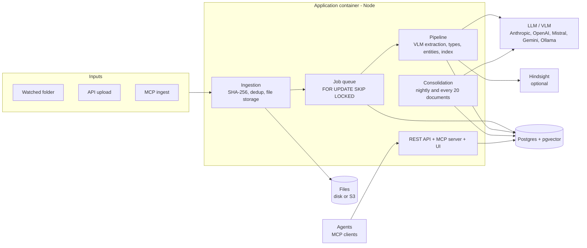
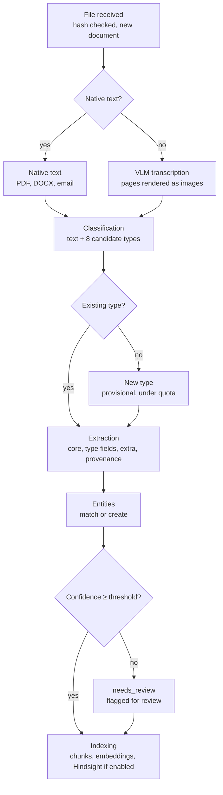

# Liasse — Specification

*Status: draft, pre-implementation. Last updated 2026-11-13.*

## Vision and principles

Liasse is a lightweight, open-source document management system built for agents first: you hand it documents, it understands them, files them into types it evolves on its own, and exposes everything over MCP. Humans never have to maintain a taxonomy.

**The problem.** Self-hosted document managers (Paperless-ngx, Papra, Readur) rely on classic OCR, manual tags and a UI designed for filing by hand. AI is a bolted-on extension. Agent memory systems (Hindsight) synthesize facts but are not a documentary source of truth.

**Design principles**

- **The file is the source of truth.** Everything else (text, fields, facts, embeddings) is derived and can be regenerated.
- **Agent first.** MCP is the primary interface; the REST API serves it; the UI is a convenience.
- **Small fixed structure, emergent types.** A common core of fields guarantees reliable queries; types and their schemas are proposed by the LLM, then consolidated.
- **Nothing is lost.** Useful information outside the schema goes into `extra`, which feeds schema evolution.
- **Traceability.** Every extracted value keeps its model, schema version, confidence and source quote.
- **Lightweight.** One application container and one Postgres. No broker, no separate worker in the MVP.
- **Swappable models.** Configurable LLM/VLM provider, including local (Ollama).

## MVP scope

The MVP covers ingestion, extraction, the evolving type registry, the knowledge layer, search, MCP and a minimal UI, for a single user. Exit criterion: ingest 200 real personal documents and correctly answer 20 reference questions over MCP.

**In scope**

- Ingestion from a watched folder, API upload and the MCP `ingest` tool.
- Formats: PDF (native or scanned), JPEG/PNG/HEIC, DOCX, `.eml` emails with attachments.
- Three-step pipeline: text (native, or transcribed by a VLM), classification, extraction of core and type fields.
- Evolving type registry with a consolidation job.
- Entity resolution (issuers, recipients).
- Hybrid search (vector + full text) and structured queries.
- MCP server (Streamable HTTP and stdio), REST API and a minimal web UI (list, preview, search, upload, `needs_review` queue, change approval), password-protected.
- Native knowledge layer (key dates, links, subjects, facts); optional sync to Hindsight.
- Deduplication by file hash.

**Out of scope for the MVP**

- Multi-user, organizations, sharing.
- Full admin UI: only the minimal UI is included.
- Ingestion by email address (IMAP), mobile apps, scanning.
- PDF editing or annotation.
- Workflows (approval, signature, reminders): that is the agents' job.
- Application-managed encryption at rest (delegated to storage).

## Architecture

Everything fits in one Node container and one Postgres database: no broker, no separate worker, the job queue lives in Postgres. The LLM is external (or local through Ollama) and Hindsight is optional.



The pipeline is the only component that calls the vision model; consolidation and re-extraction only use text already stored.

## Data model

Eleven Postgres tables: documents, text pages, chunks, types, entities, change log and job queue, plus the four knowledge-layer tables (`document_dates`, `document_links`, `subjects`, `facts`). Files live outside the database (disk or S3), addressed by their hash.

| Table | Role | Key columns |
| --- | --- | --- |
| `documents` | One ingested document | `id`, `sha256` (unique), `storage_key`, `mime`, `original_name`, `source` (watch/api/mcp), `status`, `type_id`, `schema_version`, `core` (jsonb), `fields` (jsonb), `extra` (jsonb), `provenance` (jsonb), `title`, `summary`, `private`, `ingested_at` |
| `document_pages` | Full text per page | `document_id`, `page`, `text`, `tsv` (tsvector) |
| `chunks` | Search units | `id`, `document_id`, `page_from`, `page_to`, `text`, `embedding` (vector), `tsv` |
| `doc_types` | Type registry | `id`, `slug`, `description`, `schema` (jsonb), `version`, `status`, `parent_slug`, `aliases` (text[]), `embedding`; the document count is computed from `documents`, never stored |
| `entities` | Issuers, recipients | `id`, `kind` (org/person), `canonical_name`, `aliases` (text[]), `identifiers` (jsonb: company ID, masked IBAN, customer number), `embedding` |
| `type_changes` | Consolidation proposals | `id`, `kind` (merge/promote_field/stabilize/split/rename/merge_entity/merge_subject), `payload`, `rationale`, `status` (pending/applied/rejected), `auto`, `created_at` |
| `jobs` | Processing queue | `id`, `kind`, `payload`, `status`, `attempts`, `run_after`, `locked_at` |

Knowledge-layer tables are described in [Knowledge layer](#knowledge-layer).

**Document statuses**: `received` → `extracted` → `classified` → `indexed`, or `failed` (with `error`); `needs_review` when confidence is below the threshold.

**Per-field provenance** (in `provenance`):

```json
{
  "amount": {"model": "claude-sonnet-x", "schema_version": 3, "confidence": 0.94, "page": 1, "quote": "Total TTC 84,20 €"},
  "issuer": {"entity_id": "ent_01H…", "match": "alias", "confidence": 0.99}
}
```

**Brokerless job queue**: `SELECT … FOR UPDATE SKIP LOCKED` on `jobs`, workers in the same process. Embeddings via `pgvector` (dimension fixed at install time).

## Ingestion pipeline

Each document goes through three steps: get the text, choose or create its type, extract its fields. The vision model is only called when the document has no usable text layer.



**Text.** A PDF counts as native if it holds at least 100 characters per page on average; otherwise each page is rendered as an image (200 dpi) and transcribed by the VLM, page by page, into Markdown. The fallback also works page by page, so that no text is lost: in a native PDF a page with fewer than 20 characters is transcribed by the VLM, and a scanned PDF longer than `MAX_VISION_PAGES` keeps the text layer of the pages that have one and transcribes the others, failing only when those exceed the limit. Images (JPEG, PNG, HEIC) always go through the VLM.

**Classification.** The text model receives the first 2,000 tokens of the document and the 8 closest types (similarity between the embedding of the document's opening and the embeddings of type descriptions), with their description and one example title. It answers:

```json
{
  "decision": "existing",
  "slug": "energy_bill",
  "confidence": 0.93,
  "new_type": null
}
```

or `"decision": "new"` with `new_type` = `{slug, description, parent_slug, fields}` and a two-sentence justification of why no existing type fits. The prompt enforces reuse by default. If the daily new-type quota is reached, the document gets the closest candidate type and moves to `needs_review`.

**Extraction.** Structured output constrained by a Zod schema generated from the core and the type: `core`, `fields`, `extra` (free keys, enforced primitives), `title`, `summary` (2 sentences) and, for each value, `page` and `quote`. A value without a quote verifiable in the text is rejected.

**Knowledge.** The same extraction call also produces key dates, 1 to 5 facts and candidate subjects. Link detection is a separate call, limited to candidate documents (same issuer, subject or reference, within 12 months).

**Confidence.** A document's confidence is the minimum of the classification confidence and the mean confidence of the filled core fields. Below `CONFIDENCE_THRESHOLD`, it moves to `needs_review` but stays indexed and queryable.

**Target cost**: 1 vision call per page for a scan, 3 text calls per document (classification, extraction, links), 1 embedding call per chunk.

## Evolving type registry

Each document carries two layers of fields: a fixed common core, identical for all documents, and fields specific to its type, defined by a schema the system evolves. Cross-type queries rely on the core, which never changes without a migration.

**Common core (`core`)**

| Field | Primitive | Example |
| --- | --- | --- |
| `document_date` | date | 2026-10-03 |
| `issuer` | entity | EDF |
| `recipient` | entity | Jane Doe |
| `amount` | money | `{value: 84.20, currency: "EUR"}` |
| `period` | period | `{start: 2026-09-01, end: 2026-09-30}` |
| `due_date` | date | 2026-10-18 |
| `reference` | text | invoice, contract or case number |
| `language` | ISO 639-1 enum | fr |
| `key_dates` | list of key dates | see [Knowledge layer](#knowledge-layer) |

All core fields are optional; the LLM only fills what it finds.

**Primitives allowed in type schemas**: `text`, `number`, `boolean`, `date`, `period`, `money`, `entity`, `enum` (listed values), `list<primitive>`, `identifier` (with optional `format`: IBAN, company ID, meter ID…). No free nested objects in the MVP. Schemas are stored as restricted JSON Schema, validated on every write.

**Example type**

```json
{
  "slug": "energy_bill",
  "description": "Bill from an electricity or gas supplier for a home",
  "parent_slug": "bill",
  "version": 3,
  "status": "stable",
  "aliases": ["electricity_bill", "edf_bill"],
  "fields": {
    "energy": {"type": "enum", "values": ["electricity", "gas", "dual"]},
    "meter_id": {"type": "identifier", "format": "PDL"},
    "consumption_kwh": {"type": "number"},
    "supply_address": {"type": "text"}
  }
}
```

**Type lifecycle**

- `provisional`: created at ingestion, usable immediately, schema may change.
- `stable`: promoted by consolidation after N documents (default 5) with no merge proposed.
- `merged`: absorbed by another type; its slug becomes an alias of the target and still resolves in queries.

**Versioning.** Adding a field bumps `version` without touching documents. Renaming, retyping or removing a field creates an explicit migration in `type_changes`, then a re-extraction of the affected documents. Each document keeps the `schema_version` it was extracted with.

**Enforced naming conventions**: snake_case, English, generic to specific (`energy_bill`, never `edf_october`), never an entity name, date or amount in a slug. Hierarchy (`parent_slug`) is limited to two levels. Generated slugs and field names are in English by default whatever the document's language; this is configurable with `SCHEMA_LANGUAGE`.

## Consolidation job

Consolidation prevents type drift: it runs every night and after every batch of 20 new documents, and produces proposals in `type_changes`. Safe changes apply automatically; others wait for approval over MCP or in the UI.

**Steps of a run**

1. **Merge candidates.** For each pair of types whose description similarity exceeds 0.85 (cosine), or whose documents overlap strongly in fields and entities, the LLM receives both schemas and 3 examples of each. It answers `merge` (with target and field mapping), `common_parent` or `distinct`.
2. **Field promotion.** A field present in `extra` for at least 60% of a type's documents (and at least 3 documents) becomes a candidate. The LLM proposes a canonical name and a primitive; name variants (`customer_no`, `customer_number`) are unified.
3. **Stabilization.** A `provisional` type with at least 5 documents and no open merge proposal becomes `stable`.
4. **Cleanup.** A schema field filled in fewer than 10% of the documents of a `stable` type with 20 documents or more is proposed for removal.
5. **Application.** For each applied change: registry update, alias added, then re-extraction jobs for the affected documents.

**Re-extraction.** It starts from the text stored in `document_pages`, without calling the vision model again, using the new schema. The cost is one text LLM call per document. Unchanged values keep their original provenance.

**Auto-apply policy**

| Change | Automatic | Condition |
| --- | --- | --- |
| Stabilization | Yes | Criteria above |
| Field addition (promotion) | Yes | No name or primitive conflict |
| Merge of provisional types | Yes | LLM confidence ≥ 0.9 and lossless mapping |
| Merge involving a stable type | No | Approval required |
| Field removal or retyping | No | Approval required |
| Change to the common core | Never | Code migration only |

`AUTO_APPLY=none` disables all automatic application (useful for first trials).

## Entity resolution

Entities are managed locally and deterministically: it is the most queried field ("everything from EDF") and must not depend on an external service.

**Algorithm at ingestion**, for each entity mentioned by the extraction:

1. **Strong identifier**: if a company ID, VAT number or known customer number matches, attach directly.
2. **Normalized name**: lowercase, no accents, no legal form (SA, SAS, Ltd, Inc…); equal to the canonical name or an alias → attach.
3. **Similarity**: embedding of the name and context; above 0.92, attach and add an alias; between 0.80 and 0.92, the LLM arbitrates among the 3 closest candidates.
4. **Otherwise**: create a new entity.

Entity merges go through `type_changes` (kind `merge_entity`) with the same policy: automatic if a strong identifier is shared, approval otherwise.

**Privacy**: IBANs and card numbers are never stored in clear in `identifiers`; only the last 4 characters and a hash are used for matching.

## Knowledge layer

Liasse answers relational and temporal questions on its own ("which contracts expire this quarter?", "when did I switch energy supplier?") thanks to four structures derived at ingestion. Hindsight is not required: it is an optional export.

| Structure | What it captures | Typical question |
| --- | --- | --- |
| `document_dates` | Typed key dates of each document: payment, expiry, renewal, notice, effective date | "What expires this quarter?" |
| `document_links` | Links between documents: supersedes, amends, terminates, pays, replies to, attachment of | "Is this contract still active?" |
| `subjects` | Durable files grouping documents: home, vehicle, contract, job, account | "Everything about my car" |
| `facts` | Dated atomic facts linked to their entities, subjects and source document | "When did I change insurer?" |

**Key dates (`key_dates`).** A document can carry several typed dates: `due` (payment), `expiry` (end of validity), `renewal`, `notice_deadline` (last day to give notice), `effective` (start), `event` (other). Each date keeps its label, confidence and quote. When a contract states a notice period, `notice_deadline` is computed deterministically (`renewal` − notice period), not by the LLM.

**Links and current state.** At ingestion, the LLM receives candidate documents (same issuer, subject or reference, within the last 12 months) and proposes typed links: `supersedes`, `amends`, `terminates`, `pays`, `replies_to`, `attachment_of`. These links give each document a derived state (`current`, `superseded`, `terminated`): a terminated contract no longer shows up in upcoming deadlines.

**Subjects.** Subjects are the things the user owns or holds, as opposed to entities, which are the organizations and people they deal with. Subject kinds: `property`, `vehicle`, `contract`, `employment`, `account`, `dependent`. They are resolved like entities (strong identifiers: license plate, contract number, address, then similarity), and a document can concern several subjects. Subject merges go through `type_changes` (kind `merge_subject`).

**Facts.** The extraction call produces 1 to 5 short facts per document, each with `valid_from`, `valid_to`, its entities, its subjects and the document ID. They are indexed for vector and full-text search. Recall combines hybrid search over facts, a temporal filter ("valid at date X") and a one-hop expansion through related entities and subjects. No opinions, no reflection: only sourced facts.

```text
[doc:01JC…] The MAIF home insurance contract for the Lyon apartment renews automatically every March 1st; 2-month notice period. (valid_from 2025-03-01)
```

**End-to-end example.** For "which contracts expire this quarter?", the agent calls `upcoming` with the quarter as window and kinds `expiry`, `renewal` and `notice_deadline`. Liasse returns the dates sorted, each with its document, subject and state; terminated or superseded contracts are excluded by default. The agent only calls `get_document` when it needs exact details.

## Hindsight integration (optional)

The Hindsight integration is optional: the native knowledge layer is enough for relational and temporal questions. It serves users who want their agents to find their documents in the same memory as the rest of their context. Liasse never delegates storage or exact retrieval to it.

**What is sent.** After indexing, a `retain` into a dedicated bank (default `documents`) with the document's facts (`facts` table), never its full text:

```text
[doc:01JC…] EDF energy bill dated 2026-10-03 for 2026-09-01 to 2026-09-30, amount €84.20, due 2026-10-18, supply address 12 rue des Lilas, Lyon.
```

**What is not sent**: full text, identifiers (IBAN, tax numbers), documents flagged `private`.

**Updates.** A re-extraction that changes the core or fields sends a corrected `retain` with the same ID; deleting a document triggers a forget request if the API allows it (to be checked, see open questions).

**Agent side.** Without Hindsight, the agent uses `upcoming`, `timeline` and `recall`. With Hindsight, it can also query its global memory, collect the cited `[doc:…]` IDs, then call `get_document` for exact details.

## Search

Two modes coexist: hybrid natural-language search over chunks, and structured queries over core and type fields. Both return documents with the snippets that justify the result.

**Hybrid search (`search`)**

- Full text: Postgres `tsvector` with a language-aware configuration + `unaccent` (BM25 through ParadeDB `pg_search` as an option, if installed).
- Vector: `pgvector`, HNSW index, query embedding.
- Fusion: Reciprocal Rank Fusion (k = 60), then grouping by document (best chunk + at most 2 snippets).
- Combinable filters: type (aliases resolved), entity, subject, date range, status.
- Cross-encoder reranking: out of the MVP, planned behind a flag.

**Chunking**: per page, then split at about 800 tokens with 100 tokens of overlap; document title and type are prefixed to each chunk before embedding.

**Structured queries (`query`)**: a JSON DSL compiled into parameterized SQL; agents never send SQL.

```json
{
  "type": "energy_bill",
  "where": [
    ["core.issuer", "=", "EDF"],
    ["core.document_date", ">=", "2026-01-01"],
    ["fields.consumption_kwh", ">", 300]
  ],
  "order_by": ["core.document_date", "desc"],
  "aggregate": {"sum": "core.amount.value"},
  "limit": 50
}
```

Operators: `=`, `!=`, `<`, `<=`, `>`, `>=`, `in`, `contains`, `exists`. Aggregates: `count`, `sum`, `min`, `max`, `avg`, with optional `group_by`. An unknown field returns an error listing the available fields, so the agent can correct itself.

## MCP contract

Fourteen tools, over Streamable HTTP (`/mcp`, Bearer token auth) and stdio. All outputs are compact JSON; documents are referenced by ID and never returned in full unless explicitly requested.

| Tool | Role | Main inputs | Output |
| --- | --- | --- | --- |
| `describe_types` | Discover types and their schemas | `status?`, `include_examples?` | Types with description, fields, document count, aliases |
| `search` | Hybrid natural-language search | `query`, `filters?`, `limit?` (default 10) | Documents with title, type, core, 1–3 snippets, score |
| `query` | Structured query (DSL) | DSL object | Rows (ID, core, requested fields) or aggregates |
| `get_document` | Document details | `id`, `include` (`fields`, `text`, `pages`, `file_url`, `provenance`) | Document; paginated text if long |
| `list_entities` | List or search entities | `query?`, `kind?` | Entities with aliases and document count |
| `ingest` | Add a document | `file` (base64) or `url`, `filename`, `hint?` | ID and status; asynchronous processing |
| `get_status` | Track processing | `id` | Status, error if any |
| `update_document` | Correct a document | `id`, `type?`, `core?`, `fields?`, `private?` | Updated document (provenance `manual`) |
| `list_pending_changes` | See consolidation proposals | `kind?` | Changes with rationale |
| `apply_change` | Approve or reject | `id`, `decision` (`apply`/`reject`), `note?` | Result and number of documents to re-extract |

**Knowledge-layer tools**

| Tool | Role | Main inputs | Output |
| --- | --- | --- | --- |
| `upcoming` | Key dates in a window | `from`, `to`, `kinds?`, `types?`, `subject?`, `current_only?` (default true) | Sorted dates with label, document, subject, state |
| `timeline` | Chronology of a subject or entity | `subject` or `entity`, `from?`, `to?` | Dated facts and documents, in order |
| `recall` | Fact search, memory-style | `query`, `at?` (validity date), `limit?` | Facts with validity and source document |
| `get_subject` | Subject details | `id` or `query` | Subject, linked documents, current state, next dates |

**Conventions**

- Tool descriptions guide the agent: call `describe_types` before `query`, prefer `query` for numeric questions and `search` for fuzzy ones, never invent a missing value.
- `file_url` is a signed URL valid for 15 minutes, never the storage path.
- A manual correction (`update_document`) takes precedence: consolidation never overwrites it.
- `ingest` is exposed to agents by default.
- MCP resources: `doc://{id}` (text) and `types://` (registry), for clients that support them.

## API, configuration and deployment

A single Node binary, configured through environment variables, shipped as a multi-arch Docker image (amd64, arm64) with a `docker-compose.yml` including Postgres and pgvector.

**REST API** (generated OpenAPI, same logic as MCP): `POST /documents`, `GET /documents/:id`, `GET /documents/:id/file`, `PATCH /documents/:id`, `DELETE /documents/:id`, `POST /search`, `POST /query`, `GET /types`, `GET /entities`, `GET /subjects`, `GET /upcoming`, `GET /changes`, `POST /changes/:id`, `GET /health`, `GET /metrics` (Prometheus).

**Main variables**

| Variable | Default | Role |
| --- | --- | --- |
| `DATABASE_URL` | — | Postgres 16+ with pgvector |
| `STORAGE_DRIVER` | `fs` | `fs` or `s3` |
| `STORAGE_PATH` / `S3_*` | `/data/files` | File location |
| `WATCH_DIR` | empty | Watched folder (disabled if empty) |
| `LLM_PROVIDER` | `anthropic` | `anthropic`, `openai`, `mistral`, `gemini`, `ollama`, `openai-compatible` |
| `VISION_MODEL` | — | Model for extraction from images |
| `TEXT_MODEL` | — | Model for classification, re-extraction, consolidation |
| `LLM_TIMEOUT` | `5m` | Upper bound for one text or vision model call, its retries included |
| `EMBEDDING_TIMEOUT` | `1m` | Upper bound for one embedding request, its retries included |
| `EMBEDDING_PROVIDER` / `EMBEDDING_MODEL` / `EMBEDDING_DIM` | `local` | Embeddings (dimension fixed at install time) |
| `AUTO_APPLY` | `safe` | `none`, `safe`, `all` |
| `CONFIDENCE_THRESHOLD` | `0.7` | Below: `needs_review` |
| `MAX_NEW_TYPES_PER_DAY` | `5` | Beyond: closest type + `needs_review` |
| `SCHEMA_LANGUAGE` | `en` | Language of generated slugs and field names: `en`, `fr`, `de`, `es` or `it` |
| `HINDSIGHT_URL` / `HINDSIGHT_BANK` / `HINDSIGHT_API_KEY` | empty | Optional integration |
| `API_TOKENS` | — | Bearer tokens (list) for API and MCP |
| `UI_PASSWORD` | empty | Enables the web UI (plain value or `$argon2id$…` hash) |
| `UI_SESSION_TTL` | `7d` | UI session lifetime |
| `WORKERS` | `2` | Jobs processed in parallel |

**Local embeddings by default.** `EMBEDDING_PROVIDER=local` runs a small quantized multilingual model in-process (ONNX Runtime): around 384 dimensions and roughly 100 MB, with candidates to be compared on the evaluation set (for example the multilingual-e5-small family). The model is loaded on first use and unloaded after 10 minutes of inactivity to meet the idle RAM target; embeddings are computed in batches in the job queue, with a single dedicated worker.

**Web UI.** Enabled only when `UI_PASSWORD` is set. Session cookie `HttpOnly`, `Secure`, `SameSite=Strict`, 7-day lifetime; at most 5 login attempts per minute per IP. The UI calls the same API as MCP.

**Tech stack**

- TypeScript, Node 22, Hono (HTTP), Drizzle (ORM and migrations), Zod (validation, JSON Schema generation).
- Official MCP TypeScript SDK.
- Vercel AI SDK for LLM provider abstraction, with structured outputs.
- PDF → images: `pdftoppm` (poppler) in the image; native text extraction with `pdfjs` when the PDF has a text layer, to save vision calls.
- Tests: Vitest, with a synthetic document set (no real documents in the repository).

**Resource target**: under 150 MB of RAM at idle for the application container, excluding Postgres.

## Safeguards, security and privacy

Documents are personal and sensitive (taxes, health, banking): privacy by default comes before convenience, and document content is treated as data, never as instructions.

**Prompt injection.** Text extracted from a document may contain malicious instructions. It is always passed to the LLM in a delimited block marked as untrusted; outputs are constrained by a strict Zod schema; no LLM output triggers any action other than writing validated fields. MCP tool descriptions flag document content as untrusted.

**Registry safeguards**

- Maximum number of new types per day (`MAX_NEW_TYPES_PER_DAY`).
- Capped schema size (30 fields per type), two hierarchy levels.
- Slug validation (regex, denylist: known entity names, dates, numbers).
- No automatic change to the common core.

**Privacy**

- LLM provider of your choice, including 100% local (Ollama); warning at startup when a cloud provider is configured.
- Per-document `private` flag: excluded from Hindsight, from embeddings sent to an external provider, and from `search` results unless explicitly requested.
- An embedding endpoint is external unless it is the in-process model, or an Ollama or OpenAI-compatible server whose base URL host is a loopback or private IP address, or a name that resolved at startup to such addresses only; a cloud provider is always external, and a DNS change after startup is not re-checked.
- Sensitive identifiers (IBAN, tax number, social security number) masked in `core`, `fields` and provenance; the full value is only readable in the document's full text.
- No telemetry.

**Access**: Bearer tokens for API and MCP, password for the UI, constant-time comparisons; signed, short-lived file URLs; no public listener by default (binds to `127.0.0.1` unless configured).

## Open source

Liasse is published under AGPL-3.0 at github.com/wallforfry/liasse from the first commit. AGPL prevents a closed SaaS fork and leaves the door open to a hosted offering; Apache-2.0 was ruled out for that reason.

**Contributions**: DCO required (`Signed-off-by` on every commit), no CLA.

**Language**: everything in the project is in English — code, identifiers, schemas, comments, commit messages, issues, PRs, documentation, prompts, error messages and MCP tool descriptions.

**Repository**

- pnpm monorepo: `apps/server`, `packages/core` (pipeline, registry), `packages/mcp`, `packages/sdk` (TS client), `docs/`.
- `README` focused on a 5-minute start (`docker compose up`), `CONTRIBUTING.md`, `SECURITY.md`, code of conduct.
- `AGENTS.md` (and `CLAUDE.md`) at the root: conventions, commands, testing rules, so agent-assisted contributions stay consistent.
- GitHub Actions CI: lint, tests, multi-arch image build, publication to GHCR on every tag.
- SemVer, generated changelog (Changesets).

**Public evaluation set**: 50 synthetic documents (bills, contracts, notices, fictitious payslips) with expected ground truth. It drives prompt regression tests and model comparisons, and is a good launch asset.

## Roadmap

Four milestones with no dates: each is passed on a measurable criterion, not a calendar. v0.3 matches the MVP exit criterion; v1.0 is the public launch.

| Milestone | Content | Exit criterion |
| --- | --- | --- |
| v0.1 Foundations | Ingestion, dedup; native text + VLM; hybrid search; read-only MCP; minimal UI | Search works on 50 documents |
| v0.2 Evolving types | Classification; extraction + core; versioned registry; entities, query DSL | 100 documents, fewer than 20 types |
| v0.3 Consolidation | Merges, promotions; re-extraction; approval tools; knowledge layer | 200 documents, 20 reference questions answered |
| v1.0 Public launch | Evaluation set; docs + examples; multi-arch image; announcement | — |

v0.1 is useful on its own: an archive searchable by agents, before classification even exists. "Fewer than 20 types" for 100 documents guards against drift before consolidation is turned on.

## Decisions and open questions

| Question | Decision |
| --- | --- |
| Name | Liasse; available on GitHub, npm and as a domain |
| License | AGPL-3.0 |
| Default embeddings | Local, with a lightweight model loaded on demand |
| Expose `ingest` to agents | Yes, by default |
| UI in v0.1 | Yes, a minimal UI protected by a password (`UI_PASSWORD`) |

Still open:

- [ ] Does Hindsight support targeted forgetting by memory ID? To be checked during v0.3; otherwise, document that document deletion is not propagated.
- [ ] Consolidation thresholds (0.85 similarity, 60% presence, 5 documents): to be calibrated on the evaluation set.
